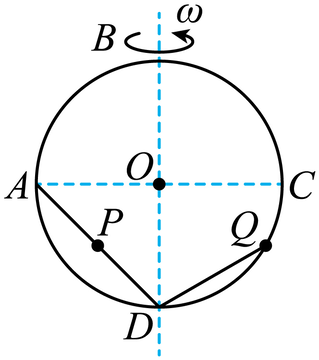

# Physics - 题目 2473

**ID**: 0a109ca26ae944e4a071dae6579fd32b
**年级**: Grade 10
**难度**: Medium
**题型**: Calculation

## 题目
如图所示，处于竖直平面内的光滑细金属圆环半径为R，A、B、C、D为圆环上的四个点，AC水平、BD竖直，A、D间固定有光滑细直杆。​​​​​​​‌质量为m的带孔小球P穿于杆上，与P相同的小球Q穿在环上，并通过长为R的结实细绳固定在D点。在圆环以BD为轴转动时，若小球P位于AD杆的中点，圆环转动的角速度为ω_{0}，求：（1）圆环的角速度ω_{0}？（2）圆环转动的角速度为ω_{0}时，细绳的弹力为多少？（3）若P与D的距离为 $\frac {\sqrt {2}}{4}R$ ，细绳的弹力为多少？

## 解答

1. （1）根据题意可知，AD杆与水平方向夹角为45°，对小球P，有 $mg{\tan}45{}^\circ =mω{{}_{0}^{2}}\cdot \frac {R}{2}$ ，解得 $ω{{}_{0}}=\sqrt {\frac {2g}{R}}$
2. （2）OQ与水平方向夹角为30°，QD与水平方向夹角为30°，对小球Q，有 $N{\cos}30{}^\circ +T{\cos}30{}^\circ =mω{{}_{0}^{2}}\cdot R{\cos}30{}^\circ $ ， $N{\sin}30{}^\circ =T{\sin}30{}^\circ +mg$ ，联立解得 $N=2mg$ ， $T=0$
3. （3）若P与D的距离为 $\frac {\sqrt {2}}{4}R$ ，则 $mg{\tan}45{}^\circ =mω{^{2}}\cdot \frac {R}{4}$ ， $N^{′}{{\rm c}}{\rm os}30{}^\circ +T^{′}{{\rm c}}{\rm os}30{}^\circ =mω{^{2}}\cdot R{\cos}30{}^\circ $ ， $N^{′}{{\rm s}}{\rm in}30{}^\circ =T^{′}{{\rm s}}{\rm in}30{}^\circ +mg$ ，联立解得 $N^{′}=3mg$ ， $T^{′}=mg$

## 知识点

**中文**:
  - 水平面内匀速圆周问题

**English**:
  - Uniform Circular Motion in Horizontal Plane

---
