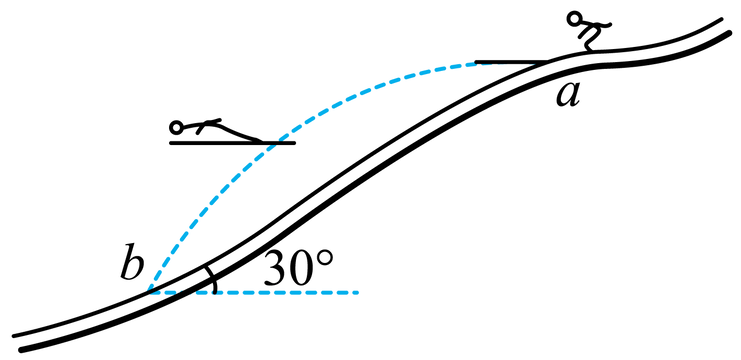

# Physics - 题目 1279

**ID**: 250149b2341240c08a1f9ee0e5b68164
**年级**: Grade 10
**难度**: Medium
**题型**: Calculation

## 题目
跳台滑雪是一种勇敢者的滑雪运动，运动员穿专用滑雪板，在滑雪道上获得一定速度后从跳台飞出，在空中飞行一段距离后着陆，现有某运动员从跳台 $a$ 处沿水平方向飞出，在斜坡 $b$ 处着陆，如图所示，测得 $ab$ 间的距离为 $40{\rm{m}}$ ，斜坡与水平方向的夹角为 $30{}\degree $ ，不计空气阻力， $g$ 取 $10{\rm{m}}/{\rm{s}}{^{2}}$ 。​​​​​​​‌求：（结果保留根号）（1）运动员在 $a$ 处的速度大小 $v{{}_{0}}$ ；（2）运动员在空中离坡面的最大距离 $d$ 。

## 解答

1. （1）运动员从a处运动到b处，做平抛运动，根据平抛运动规律 $L\sin 30{}\degree =\frac {1}{2}gt{^{2}}$ ， $L{\cos}30{}\degree =v{{}_{0}}t$
2. 解得 $v{{}_{0}}=10\sqrt {3}{\rm{m}}/{\rm{s}}$
3. （2）当运动员的速度方向与坡面平行时，运动员离坡面最远，则 ${\tan}30{}\degree =\frac {gt{{}_{1}}}{v{{}_{0}}}$
4. 解得 $t{{}_{1}}=1{\rm{s}}$
5. 根据正交分解法，将运动员的运动分解到垂直斜面向上方向和沿斜面向下方向的两个分运动，在垂直斜面方向上，做匀减速直线运动，初速度 $v{{}_{0y}}=v{{}_{0}}\sin 30{}\degree $
6. 加速度 $a=g{\cos}30{}\degree $
7. 设最远距离为d，则 $d=\frac {v{{}_{0y}}{^{2}}}{2a}$
8. 联立解得 $d=\frac {5\sqrt {3}}{2}{\rm{m}}$

## 知识点

**中文**:
  - 平抛运动与斜面、圆轨道相结合问题

**English**:
  - Horizontal Projectile on Inclined Planes and Circular Tracks

---
