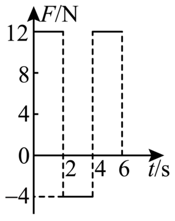

# Physics - 题目 1048

**ID**: 2653edf3385f4d97a272eceee4927ac0
**年级**: Grade 10
**难度**: Medium
**题型**: Calculation

## 题目
一个质量为4 kg的物体静止在足够大的水平地面上，物体与地面间的动摩擦因数μ＝0.2。​​​​​​​‌从t＝0开始，物体受到一个大小和方向呈周期性变化的水平力F的作用，力F随时间t变化的规律如图所示。g取10 m/s^{2}。求：（结果可用分式表示）（1）在2~4 s时间内，物体从开始做减速运动到停止所经历的时间；（2）0~6 s内物体的位移大小。

## 解答

1. （1）0~2 s内，由牛顿第二定律和运动学公式得
2. F_{1}－μmg＝ma_{1}
3. v_{1}＝a_{1}t_{1}
4. 2~4 s内，由牛顿第二定律和运动学公式得
5. F_{2}－μmg＝ma_{2}
6. 0－v_{1}＝a_{2}t_{2}
7. 解得物体从开始做减速运动到停止所用时间
8. t_{2}＝ $\frac {2}{3}$ s
9. （2）0~2 s内物体的位移
10. x_{1}＝ $\frac {v{{}_{1}}t{{}_{1}}}{2}$
11. 2~4 s内物体的位移
12. x_{2}＝ $\frac {v{{}_{1}}t{{}_{2}}}{2}$
13. 由周期性可知4~6 s内和0~2 s内物体的位移相同，
14. 所以0~6 s内物体的位移大小为
15. x＝2x_{1}＋x_{2}＝ $\frac {14}{3}$ m

## 知识点

**中文**:
  - 两类动力学问题

**English**:
  - Two Types of Dynamics Problems

---
