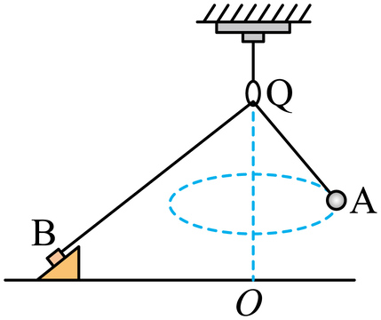

# Physics - 题目 2736

**ID**: 29b1f575f9d8453385c4b5e08640fd07
**年级**: Grade 10
**难度**: Medium
**题型**: Calculation

## 题目
如图所示，一轻质光滑圆环 ${\rm{Q}}$ 通过一竖直轻杆悬挂在可绕竖直轴旋转的装置上， ${\rm{Q}}$ 在水平地面上的投影为 $O$ ， $QO$ 的高度为 $H=\frac {43}{90}{\rm{m}}$ ， $QB$ 平行于斜面。​​​​​​​‌一条轻绳穿过圆环 ${\rm{Q}}$ ，两端分别连接物块 ${\rm{B}}$ 和小球 ${\rm{A}}$ ，当小球 ${\rm{A}}$ 自然下垂时， ${\rm{B}}$ 静止在倾角 $θ=30{}\degree $ 的斜面上恰好不下滑。已知物块 ${\rm{B}}$ 和斜面间的动摩擦因数 $μ=\frac {\sqrt {3}}{6}$ ，球 ${\rm{A}}$ 的质量为 $m=0.5{\rm{k}}{\rm{g}}$ ，重力加速度 $g$ 取 $10{\rm{m}}/{\rm{s}}{^{2}}$ ，最大静摩擦力等于滑动摩擦力，求：(1)物块 ${\rm{B}}$ 的质量；(2)若 $QA$ 的长度为 $L=\frac {5}{6}{\rm{m}}$ ，现使 ${\rm{A}}$ 在水平面内做圆周运动，要使滑块 $B$ 相对斜面不滑动，细绳的最大拉力为多大及小球 ${\rm{A}}$ 转动的最大角速度为多大；(3)在（2）的条件下，小球 ${\rm{A}}$ 以最大角速度转动时，细绳突然断裂，小球落地时距离 $O$ 的距离为多少。

## 解答

1. （1）对A ，当小球 ${\rm{A}}$ 自然下垂时 $T=mg$
2. 设B的质量为M，对B有 $Mg\sin θ=μMg{\cos}θ+T$
3. 代入题中数据，联立解得 $M=2{\rm{k}}{\rm{g}}$
4. （2）设细绳的最大拉力为 $T^{′}$ ，则有 $T^{′}=Mg\sin θ+μMg{\cos}θ$
5. 联立解得 $T^{′}=15{\rm{N}}$
6. 设角速度最大时与 ${\rm{A}}$ 连接的绳子与竖直方向的夹角为 $α$ ，对A，由牛顿第二定律有 $T^{′}{{\rm s}}{\rm in}α=mω{^{2}}L\sin α$
7. 可知细绳拉力越大，角速度越大，当 $T^{′}=15{\rm{N}}$ 时，解得 $ω=6{\rm{r}}{\rm{a}}{\rm{d}}/{\rm{s}}$
8. （3）由 $mg=T^{′}{\cos}α$
9. 几何关系有 ${\cos}α=\frac {mg}{T^{′}}=\frac {5}{15}=\frac {1}{3}$ ， $\sin α=\frac {2\sqrt {2}}{3}$
10. 小球做圆周运动的半径 $r=L\sin α=\frac {5\sqrt {2}}{9}{\rm{m}}$
11. 小球做圆周运动的速度 $v=ωr=\frac {10\sqrt {2}}{3}{\rm{m}}/{\rm{s}}$
12. 剪断细绳后，小球做平抛运动，平抛的高度 $h=H-L{\cos}α=0.2{\rm{m}}$
13. 根据平抛规律有 $h=\frac {1}{2}gt{^{2}}$ ， $x=vt$
14. 小球距离 $O$ 的距离为 $s=\sqrt {x{^{2}}+r{^{2}}}$
15. 联立解得 $s=\frac {\sqrt {122}}{9}{\rm{m}}$

## 知识点

**中文**:
  - 圆锥摆问题

**English**:
  - Conical Pendulum Problems

---
