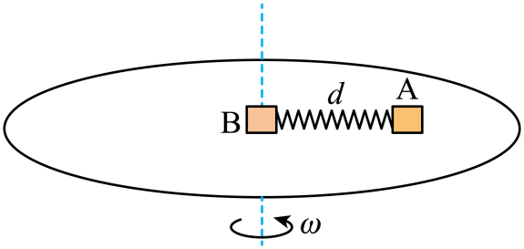

# Physics - 题目 504

**ID**: 4525869ebd5845b2a968ed1b4ed0f256
**年级**: Grade 10
**难度**: Medium
**题型**: Calculation

## 题目
如图所示在足够大的转盘中心固定一个小物块B，距离中心为r_{0}=0.2 m处放置小物块A，A、B质量均为m=1 kg，A与转盘之间的动摩擦因数为μ_{1}=0.5，现在用原长为d=0.2 m、劲度系数k=40 N/m的轻质弹簧将两者拴接，重力加速度g=10 m/s^{2}，假设弹簧始终处于弹性限度以内，最大静摩擦力等于滑动摩擦力，则：（1）缓慢增加转盘转动的角速度，求A即将打滑时的ω_{0}；（2）若转盘的角速度ω_{1}=6 rad/s，A可以放置在离中心距离不同的位置上，且A始终不打滑，求满足条件的A转动半径r_{A}的大小范围。​​​​​​​‌

## 解答

1. （1）设盘的角速度为 $ω{{}_{0}}$ 时，物块A将开始滑动，则 $μ{{}_{1}}mg=mω{{}_{0}^{2}}r{{}_{0}}$ ，代入数值解得A即将打滑时 $ω{{}_{0}}=5{\rm{\;}}{\rm{r}}{\rm{a}}{\rm{d}}{\rm{/}}{\rm{s}}$ 。
2. （2）A放置在离中心距离不同的位置上弹力不同，由临界条件可得，当摩擦力指向圆心时 $F{{}_{1}}+f=mω{{}_{1}^{2}}r{{}_{1}}$ ，当摩擦力背离圆心时 $F{{}_{2}}-f=mω{{}_{2}^{2}}r{{}_{2}}$ ，其中 $f=μ{{}_{1}}mg$ ，由胡克定律可知 $F{{}_{1}}=k（r{{}_{1}}-r{{}_{0}}）$ ， $F{{}_{2}}=k（r{{}_{2}}-r{{}_{0}}）$ ，代入数值解得 $r{{}_{1}}=0.75{\rm{\;}}{\rm{m}}$ ， $r{{}_{2}}=3.25{\rm{\;}}{\rm{m}}$ ，故满足条件的A转动半径 $r{{}_{A}}$ 的大小范围 $0.75{\rm{\;}}{\rm{m}}⩽r{{}_{A}}⩽3.25{\rm{\;}}{\rm{m}}$ 。

## 知识点

**中文**:
  - 水平面内匀速圆周问题

**English**:
  - Uniform Circular Motion in Horizontal Plane

---
