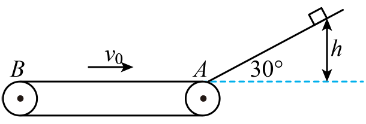

# Physics - 题目 1480

**ID**: 4598bb1e594241d08e3da9182bc4c789
**年级**: Grade 10
**难度**: Medium
**题型**: Calculation

## 题目
如图所示，倾角为θ=30°的光滑斜面的下端有一水平传送带，传送带正以v_{0}=4 m/s的速度运动，运动方向如图所示。​​​​​​​‌一个质量为m=2 kg的物体（可以视为质点），从h=3.2 m高处由静止沿斜面下滑，物体经过A点时，无论是从斜面到传送带还是从传送带到斜面，都不计其速率变化。物体与传送带间的动摩擦因数为μ=0.4，传送带左右两端A、B间的距离L_{AB}=10 m，重力加速度g=10 m/s^{2}，求∶（1）物体在传送带上向左最多能滑到距A多远。（2）物体第一次从A点滑入到再一次回到A点的时间。

## 解答

1. （1）对物体在斜面上运动，根据牛顿第二定律有
2. mgsinθ=ma
3. 解得
4. a=5 m/s^{2}
5. 根据位移时间关系式有
6. $\frac {h}{{\rm{s}}{\rm{i}}{\rm{n}}θ}=\frac {1}{2}{\rm \mathit{a}}$  $t{{}_{1}^{2}}$
7. 解得
8. t_{1}=1.6 s
9. 物体滑至斜面底端时的速度
10. v=at_{1}=8 m/s
11. 物体在传送带上运动的加速度大小
12. a_{1}=μg=4 m/s^{2}
13. 物体在传送带上速度为零时离A最远，此时有
14. ${\rm \mathit{x}=}\frac {v{^{2}}}{2a{{}_{1}}}{\rm =8}$  m
15. （2）物体在传送带上速度减为零后，向右做匀加速直线运动，速度达到传送带速度后做匀速直线运动，所以物体返回到A点的速度为4 m/s。
16. 减速时间为
17. ${\rm \mathit{t}\mathit{_{2}}=}\frac {v}{a{{}_{1}}}{\rm =2}$  s
18. 加速时间为
19. ${\rm \mathit{t}\mathit{_{3}}=}\frac {v{{}_{0}}}{a{{}_{1}}}=\frac {4}{4}$  s=1 s
20. 加速过程的位移为
21. ${\rm \mathit{x}\mathit{_{1}}=}\frac {1}{2}{\rm \mathit{a}\mathit{_{1}}}$  $t{{}_{3}^{2}}=\frac {1}{2}{\rm ×4×1^{2}}$  m=2 m
22. 匀速过程的位移为
23. x_{2}=x-x_{1}=6 m
24. 匀速运动的时间为
25. ${\rm \mathit{t}\mathit{_{4}}=}\frac {x{{}_{2}}}{v{{}_{0}}}=\frac {6}{4}$  s=1.5 s
26. 所以总时间为
27. t=t_{2}+t_{3}+t_{4}=4.5 s

## 知识点

**中文**:
  - 传送带模型

**English**:
  - Conveyor Belt Model

---
