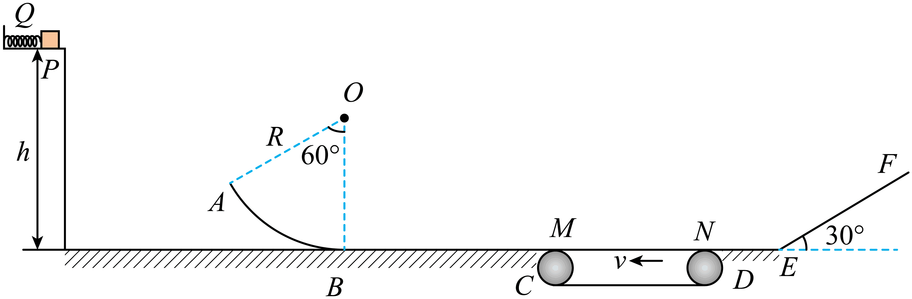

# Physics - 题目 373

**ID**: 4845baa9dbf74a1fa5192671e236885a
**年级**: Grade 10
**难度**: Medium
**题型**: Calculation

## 题目
如图所示，是处于竖直平面内某探究装置的示意图，它由水平弹射装置Q、圆心角为 $α=60{}\degree $ 的光滑圆弧轨道AB、水平轨道BC、水平传送带MN、光滑水平轨道DE和倾角为30°的光滑且足够长的斜面EF组成。​​​​​​​‌弹射装置Q距离水平轨道BCDE的高度 $h={{2}}.{{6}}{\rm{m}}{\rm ，\mathit{B}}$ 点位于圆弧轨道圆心O点的正下方，BC、MN、DE位于同一水平面上，各处光滑连接。已知可视为质点的滑块质量 $m=0.{{2}}{\rm{k}}{\rm{g}}$ ，圆弧轨道AB的半径 $R={{1}}.{{6}}{\rm{m}}$ ，轨道BC长度 $l{{}_{BC}}={{2}}.{{5}}{\rm{m}}$ ，传送带MN长度 $l{{}_{MN}}={{2}}{\rm{m}}$ ，滑块与轨道BC间的动摩擦因数为 $μ{{}_{{{1}}}}=0.{{4}}$ 、与传带MN间的动摩擦因数为 $μ{{}_{2}}=0.5$ ，其它摩擦和阻力均不计， $\sin 60{}\degree =\frac {\sqrt {3}}{2}$ ， ${\cos}60{}\degree =\frac {1}{2}$ 。滑块在弹射装置作用下以某一速度离开平台P做平抛运动，恰好可以沿切线方向进入圆弧轨道AB，传送带以一定的速度v（ $v\leqslant {{6}}{\rm{m}}/{\rm{s}}$ ）逆时针转动。求：（1）水平弹射装置对滑块做的功；（2）滑块第一次运动到B处时，对圆弧轨道的压力；（3）滑块最终静止在轨道BC时的位置距B的距离与传送带速度v的关系。

## 解答

1. （1）滑块运动到A点过程中为平抛运动，竖直方向 $h-R（1-{\cos}α）=\frac {1}{2}gt{^{2}}$ ，解得 $t=0.6{\rm{s}}$ ，则在A点竖直方向的分速度为 $v{{}_{Ay}}=gt=6{\rm{m}}{\rm{/}}{\rm{s}}$ ，恰好可以沿切线方向进入圆弧轨道，在A点 ${\tan}α=\frac {v{{}_{Ay}}}{v{{}_{Ax}}}=\sqrt {3}$ ，解得 $v{{}_{Ax}}=2\sqrt {3}{\rm{m}}{\rm{/}}{\rm{s}}$ ，则根据动能定理水平弹射装置对滑块做的功为 $W=\frac {1}{2}mv{{}_{Ax}^{2}}=1.2{\rm{J}}$
2. （2）在A点时的速度大小为 $v{{}_{A}}=\sqrt {v{{}_{Ax}^{2}}+v{{}_{Ay}^{2}}}=4\sqrt {3}{\rm{m}}{\rm{/}}{\rm{s}}$ ，滑块从A点到B点，根据动能定理 $mgR（1-{\cos}α）=\frac {1}{2}mv{{}_{B}^{2}}-\frac {1}{2}mv{{}_{A}^{2}}$ ，解得 $v{{}_{B}}=8{\rm{m}}{\rm{/}}{\rm{s}}$ ，设滑块受到的支持力为N，则根据牛顿第二定律 $N-mg=m\frac {v{{}_{B}^{2}}}{R}$ ，解得 $N=10{\rm{N}}$ ，根据牛顿第三定律，滑块对圆弧轨道的压力等于轨道对滑块的支持力 $F{{}_{压}}=N=10{\rm{N}}$
3. （3）滑块第一次运动到D点时，根据动能定理 $-μ{{}_{1}}mgl{{}_{BC}}-μ{{}_{2}}mgl{{}_{MN}}=\frac {1}{2}mv{{}_{D}^{2}}-\frac {1}{2}mv{{}_{B}^{2}}$ ，解得 $v{{}_{D}}=2\sqrt {6}{\rm{m}}{\rm{/}}{\rm{s}}$ ，根据运动的对称性，第二次运动到D点时的速度大小仍为 $v{{}_{D}}=2\sqrt {6}{\rm{m}}{\rm{/}}{\rm{s}}$ ，则在传送带上的加速度为 $a=\frac {μ{{}_{2}}mg}{m}=5{\rm{m}}{\rm{/}}{\rm{s}}{^{2}}$ ，假设滑块可以在传送带上一直加速，则 $2al{{}_{MN}}=v{^{2}}-v{{}_{D}^{2}}$ ，解得 $v=2\sqrt {11}{\rm{m}}{\rm{/}}{\rm{s}}>6{\rm{m}}{\rm{/}}{\rm{s}}$ ，所以假设不成立。假设滑块可以在传送带上一直减速，则 $2al{{}_{MN}}=v{{}_{D}^{2}}-v{{}_{1}^{2}}$ ，解得 $v{{}_{1}}=2{\rm{m}}{\rm{/}}{\rm{s}}$ ，所以，若传送带的速度为 $0<v\leqslant 2{\rm{m}}{\rm{/}}{\rm{s}}$ ，则滑块在传送带上一直减速，滑块第二次通过C点时的速度大小为 $v{{}_{1}}=2{\rm{m}}{\rm{/}}{\rm{s}}$ ，设距B的距离为x，根据动能定理 $-μ{{}_{1}}mg（l{{}_{BC}}-x）=0-\frac {1}{2}mv{{}_{1}^{2}}$ ，解得 $x=2{\rm{m}}$ ，若传送带的速度为 $6{\rm{m}}{\rm{/}}{\rm{s}}\geqslant v>2{\rm{m}}{\rm{/}}{\rm{s}}$ ，则滑块在传送带上先加速后匀速，滑块离开传送带时的速度等于传送带的速度。若滑块恰好停在B点，则 $-μ{{}_{1}}mgl{{}_{BC}}=0-\frac {1}{2}mv{{}_{2}^{2}}$ ，解得 $v{{}_{2}}=2\sqrt {5}{\rm{m}}{\rm{/}}{\rm{s}}$ ，则若传送带的速度为 $2\sqrt {5}{\rm{m}}{\rm{/}}{\rm{s}}\geqslant v>2{\rm{m}}{\rm{/}}{\rm{s}}$ ，则根据动能定理 $-μ{{}_{1}}mg（l{{}_{BC}}-x）=0-\frac {1}{2}mv{^{2}}$ ，解得 $x=\frac {20-v{^{2}}}{8}{\rm{m}}$ ，若传送带的速度为 $2\sqrt {5}{\rm{m}}{\rm{/}}{\rm{s}}<v\leqslant 6{\rm{m}}{\rm{/}}{\rm{s}}$ ，则滑块第三次经过B点后 $-μ{{}_{1}}mg（l{{}_{BC}}+x）=0-\frac {1}{2}mv{^{2}}$ ，解得 $x=\frac {v{^{2}}-20}{8}{\rm{m}}$ ，综上，若传送带的速度为 $0<v\leqslant 2{\rm{m}}{\rm{/}}{\rm{s}}$ ，则 $x=2{\rm{m}}$ ；若传送带的速度为 $2\sqrt {5}{\rm{m}}{\rm{/}}{\rm{s}}\geqslant v>2{\rm{m}}{\rm{/}}{\rm{s}}$ ，则 $x=\frac {20-v{^{2}}}{8}{\rm{m}}$ ；若传送带的速度为 $2\sqrt {5}{\rm{m}}{\rm{/}}{\rm{s}}<v\leqslant 6{\rm{m}}{\rm{/}}{\rm{s}}$ ， $x=\frac {v{^{2}}-20}{8}{\rm{m}}$ 。

## 知识点

**中文**:
  - 应用动能定理求解多阶段、多过程问题

**English**:
  - Multi-stage/Multi-process Problems

---
