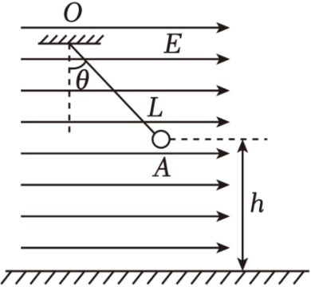

# Physics - 题目 1214

**ID**: 7033fa74e8204e9188dee32b5c5341a8
**年级**: Grade 10
**难度**: Medium
**题型**: Calculation

## 题目
如图所示，用一条长度为L的绝缘轻绳悬挂一个带正电的小球，小球质量为m，所带电荷量为q。​​​​​​​‌现在水平地面上方整个空间加一水平向右的匀强电场，小球静止时绝缘轻绳与竖直方向成 $37{}\degree $ 角，小球离地的竖直高度为h，重力加速度大小为 ${\rm \mathit{g}，}\sin 37{}\degree =0.6$ ， ${\cos}37{}\degree =0.8$ 。求：（1）匀强电场的电场强度大小；（2）若突然剪断轻绳，小球受到的合力大小；（3）若突然剪断轻绳，小球落地时的速度大小。

## 解答

1. （1）对小球受力分析，如图所示，
2. 
3. 由平衡知识可知 $Eq=mg{\tan}37{}\degree $ ，解得 $E=\frac {mg{\tan}37{}\degree }{q}=\frac {3mg}{4q}$ 。
4. （2）剪断轻绳后，小球受到重力和电场力的作用，合力为 $F{{}_{合}}=\frac {mg}{{\cos}37{}\degree }=\frac {5}{4}mg$ 。
5. （3）根据牛顿第二定律可得 $ma=\frac {mg}{{\cos}37{}\degree }$ ，由几何知识可知 $\frac {h}{x}={\cos}37{}\degree $ ，由运动学公式可知 $v{^{2}}=2ax$ ，解得 $v=\frac {5}{4}\sqrt {2gh}$ 。

## 知识点

**中文**:
  - 带电粒子（物体）在重力场和电场组成的复合场中的运动

**English**:
  - Motion in Gravity and Electric Composite Fields

---
