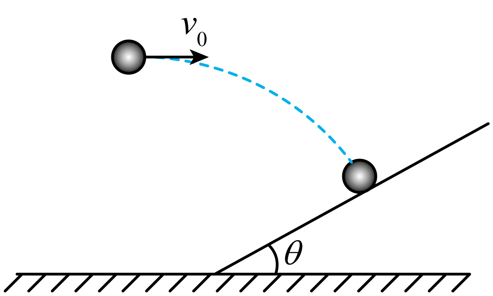

# Physics - 题目 844

**ID**: 7a17b8f891374946923227a839515b1a
**年级**: Grade 10
**难度**: Medium
**题型**: Calculation

## 题目
载人登月计划是我国的“探月工程”计划中实质性的目标。​​​​​​​‌假设宇航员登上月球后，以初速度 $v{{}_{0}}$ 水平抛出一个小球，测得小球经时间t垂直落到倾角为 $θ$ 的斜坡上。已知引力常量为G，月球的半径为R，不考虑月球自转的影响，求：（1）月球表面的重力加速度；（2）月球的密度；（3）人造卫星绕月球表面做匀速圆周运动的最小周期T。

## 解答

1. （1）以初速度 $v{{}_{0}}$ 水平抛出一个小球，测得小球经时间t垂直落到倾角为 $θ$ 的斜坡上，则有 ${\tan}θ=\frac {v{{}_{0}}}{v{{}_{y}}}$ ， $v{{}_{y}}=gt$
2. 解得月球表面的重力加速度为 $g=\frac {v{{}_{0}}}{t{\tan}θ}$
3. （2）假设月球表面一物体质量为m，有 $G\frac {Mm}{R{^{2}}}=mg$
4. 又 $M=ρ\cdot \frac {4}{3}\mathrm{π}R{^{3}}$
5. 联立解得月球的密度为 $ρ=\frac {3v{{}_{0}}}{4πGRt{\tan}θ}$
6. （3）人造卫星绕月球表面做匀速圆周运动的最小周期等于卫星靠近月球表面绕月球做匀速圆周运动的周期，由万有引力提供向心力为 $G\frac {Mm}{R{^{2}}}=m\frac {4π{^{2}}}{T{^{2}}}R$
7. 联立解得 $T=2π\sqrt {\frac {Rt{\tan}θ}{v{{}_{0}}}}$

## 知识点

**中文**:
  - 万有引力定律问题的分析与计算
  - 平抛运动与斜面、圆轨道相结合问题

**English**:
  - Analysis and Calculation of Gravitation Problems
  - Horizontal Projectile on Inclined Planes and Circular Tracks

---
