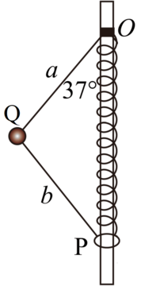

# Physics - 题目 132

**ID**: 81dc4f26269246c380e24f5b02998df9
**年级**: Grade 10
**难度**: Medium
**题型**: Calculation

## 题目
一离心调速装置如图所示，两根轻杆a、b与小球Q及圆环P通过铰链（杆可以绕铰链自由转动）连接，轻杆长均为L，Q、P的质量均为m，轻杆a的上端通过铰链固定在竖直转轴上的O点，套在转轴上的轻质弹簧连接在O点与圆环P之间，弹簧原长为 $\frac {7}{5}L$ 。​​​​​​​‌装置静止时，轻杆与转轴的夹角均为37°。绕转轴转动该装置并缓慢增大转速，圆环缓慢上升，使轻杆与转轴的夹角均变为53°。弹簧始终在弹性限度内，忽略一切摩擦和空气阻力，重力加速度为 ${\rm \mathit{g}，}\sin 37\mathrm{°}=0.6$ ， ${\cos}37\mathrm{°}=0.8$ 。求：（1）装置静止时，轻杆a对小球Q弹力的大小；（2）弹簧的劲度系数；（3）轻杆与竖直方向夹角为53°时该装置转动的角速度大小。

## 解答

1. （1）装置静止时，设a、b杆中的弹力分别为 $F{{}_{1}}$ 、T_{1}，Q受力平衡，则有 $F{{}_{1}}{\cos}37{}\degree +T{{}_{1}}{\cos}37{}\degree =mg$ ， $F{{}_{1}}\sin 37{}\degree =T{{}_{1}}\sin 37{}\degree $ ，联立，解得 $F{{}_{1}}=\frac {5}{8}mg$
2. （2）装置静止时，P受到弹簧的弹力为 $F{{}_{弹1}}=k\left ({2L{\cos}37{}\degree -\frac {7}{5}L}\right )=0.2kL$ ，方向竖直向上。P受力平衡，则有 $F{{}_{弹1}}=mg+T{{}_{1}}{\rm{c}}{\rm{o}}{\rm{s}}37{}\degree $ ，解得 $k=\frac {15mg}{2L}$
3. （3）轻杆与竖直方向夹角为53°时，设a、b杆中的弹力分别为 $F{{}_{2}}$ 、T_{2}，P受到的弹力为 $F{{}_{弹2}}=k\cdot \left ({\frac {7}{5}L-2L{\rm{c}}{\rm{o}}{\rm{s}}53{}\degree }\right )=0.2kL=1.5mg$ ，方向竖直向下。P受力平衡，有 $T{{}_{2}}{\rm{c}}{\rm{o}}{\rm{s}}53{}\degree =mg+F{{}_{弹2}}$ ，解得 $T{{}_{2}}=\frac {25mg}{6}$ ，对Q有 $F{{}_{2}}{\cos}53{}\degree =T{{}_{2}}{\cos}53{}\degree +mg$ ， $F{{}_{2}}\sin 53{}\degree +T{{}_{2}}\sin 53{}\degree =mω{^{2}}L\sin 53{}\degree $ ，解得 $ω=\sqrt {\frac {10g}{L}}$

## 知识点

**中文**:
  - 水平面内匀速圆周问题

**English**:
  - Uniform Circular Motion in Horizontal Plane

---
