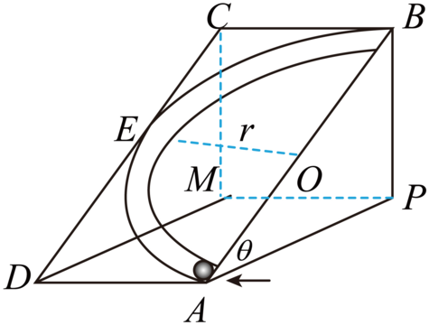

# Physics - 题目 1400

**ID**: 84be271298204a90b6ca21e0fbff3fb3
**年级**: Grade 10
**难度**: Medium
**题型**: Calculation

## 题目
如图所示，倾角为 $θ=37{}\degree $ 的斜面体固定放置在水平地面上，在斜面上固定放置一个半圆管轨道AEB，圆管的内壁光滑，半径为r，最低点A、最高点B的切线水平，AB是半圆管轨道的直径，现让质量为m的小球（视为质点）从A点以一定的水平速度滑进圆管，圆管的内径略大于小球的直径，重力加速度为 ${\rm \mathit{g}，}\sin 37\mathrm{°}=0.6$ 、 ${\cos}37\mathrm{°}=0.8$ ，求：（1）若小球在A的加速度大小为4.4g，到达B时的加速度大小为2g，则A点对小球沿斜面向上弹力大小与B点对小球沿斜面向下的弹力大小之差为多少；（2）若小球到达B点时沿斜面上下侧受到的弹力刚好为0，则小球的落地点与B点间的距离为多少；（3）若小球到达B点受到的弹力大小为0.4mg，则在此弹力作用下的两种平抛运动的水平位移之差的绝对值为多少。​​​​​​​‌

## 解答

1. （1）小球在A的加速度大小为4.4g时 $F{{}_{1}}-mg\sin θ=m\times 4.4g$
2. 到达B时的加速度大小为2g时 $F{{}_{2}}{{+}}mg\sin θ=m\times 2g$
3. 解得 $F{{}_{1}}-F{{}_{2}}=3.6mg$
4. （2）小球到达B点时沿斜面上下侧受到的弹力刚好为0，则有 $mg\sin θ=m\frac {v{{}_{0}^{2}}}{r}$
5. 小球从B点飞出后有 $2r\sin θ=\frac {1}{2}gt{{}_{0}^{2}}$ ， $x{{}_{0}}=v{{}_{0}}t{{}_{0}}$
6. 小球的落地点与B点间的距离为 $L=\sqrt {x{{}_{0}^{2}}+{\left({2r\sin θ}\right)^{2}}}$
7. 解得 $L=\frac {6\sqrt {2}}{5}r$
8. （3）小球到达B点受到的弹力大小为0.4mg，当该弹力方向沿斜面向下时 $0.4mg+mg\sin θ=m\frac {v{{}_{1}^{2}}}{r}$
9. 当该弹力方向沿斜面向上时 $mg\sin θ-0.4mg=m\frac {v{{}_{2}^{2}}}{r}$
10. 由于平抛高度一定，此两种情况下小球飞出至落地时间与（2）中相同，则水平位移之差的绝对值为 $Δx=v{{}_{1}}t{{}_{0}}-v{{}_{2}}t{{}_{0}}$
11. 解得 $Δx=\frac {2\left ({\sqrt {15}-\sqrt {3}}\right )}{5}r$

## 知识点

**中文**:
  - 倾斜面内的圆周运动问题

**English**:
  - Circular Motion on Inclined Planes

---
