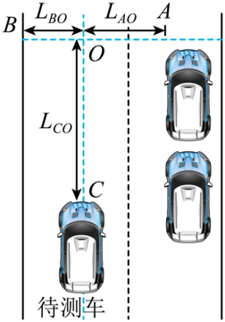

# Physics - 题目 114

**ID**: 8a03a9a609cd484ead42ed388c7c4ab2
**年级**: Grade 10
**难度**: Medium
**题型**: Calculation

## 题目
新能源汽车的智驾系统能够自主决策紧急制动。​​​​​​​‌某新能源汽车在初速为108km/h紧急制动测试中，制动距离为 $x=45{\rm{m}}$ 。如下图所示该车又进行自主决策紧急制动测试，待测车以 $v{{}_{1}}=36{\rm{k}}{\rm{m}}{\rm{/}}{\rm{h}}$ 沿直线CO匀速行驶，车上智驾系统突然探测到“儿童”以 $v{{}_{2}}=1.5{\rm{m}}{\rm{/}}{\rm{s}}$ 恒定速度从前方停靠车辆车头A处窜出沿直线AB运动，智驾系统感知分析后实施紧急制动。已知 $L{{}_{AO}}=3.0{\rm{m}}$ ， $L{{}_{BO}}=1.5{\rm{m}}$ ， $L{{}_{CO}}=16{\rm{m}}$ ，汽车制动过程视为匀减速直线运动，“儿童”视为质点。(1)求紧急制动过程中的加速度大小；(2)已知该车智驾系统反应时间（从探测到“儿童”到实施紧急制动） $\Delta t=0.2{\rm{s}}$ ，求该车停下时车头离O的距离；(3)过早或频繁紧急制动不利于行车安全和驾乘舒适，若系统经过 $\Delta t=0.2{\rm{s}}$ ，未实施紧急制动，而是控制汽车在“儿童”到达路边B处时，车头恰好到达O点，则此次制动过程加速度为多大？

## 解答

1. （1） $v{{}_{0}}=108{\rm{k}}{\rm{m}}{\rm{/}}{\rm{h}}=30{\rm{m}}{\rm{/}}{\rm{s}}$
2. 根据 $2ax=v{{}_{0}^{2}}-0$
3. 得紧急制动过程中的加速度： $a=10{\rm{m}}{\rm{/}}{\rm{s}}{^{2}}$
4. （2）因为 $\Delta t=0.2{\rm{s}}$ ，
5. 匀速的位移： $x{{}_{1}}=v{{}_{1}}\cdot \Delta t=2{\rm{m}}$
6. 减速过程： $2ax{{}_{2}}=v{{}_{1}^{2}}-0$
7. 得： $x{{}_{2}}=5{\rm{m}}$
8. 车头离O点距离： $s=L{{}_{CO}}-x{{}_{1}}-x{{}_{2}}=9{\rm{m}}$
9. （3）“儿童”运动时间： $t=\frac {L{{}_{AO}}+L{{}_{BO}}}{v{{}_{2}}}=3{\rm{s}}$
10. 车运动时间： $t{{}_{2}}=t{{}_{1}}-\Delta t=2.8{\rm{s}}$
11. 根据 $x{{}_{2}}=L{{}_{CO}}-x{{}_{1}}=v{{}_{1}}t{{}_{2}}-\frac {1}{2}at{{}_{2}}{^{2}}$
12. 得： $a=\frac {25}{7}{\rm{m}}{\rm{/}}{\rm{s}}{^{2}}$

## 知识点

**中文**:
  - 匀变速直线运动基本公式的灵活应用

**English**:
  - Flexible Application of Basic UVRM Formulas

---
