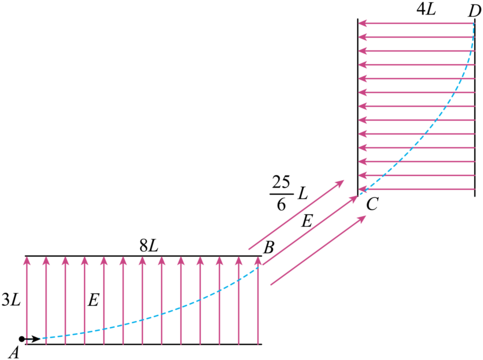

# Physics - 题目 1068

**ID**: 95c950253636437d883df8cc6acc581c
**年级**: Grade 10
**难度**: Medium
**题型**: Calculation

## 题目
如图所示，水平放置的带电平行板长度为8L，间距为3L，板间的匀强电场的场强为E，倾斜向上的有界匀强电场的场强大小也为E，竖直放置的带电平行板的间距为4L，一带电粒子（重力忽略不计）的质量为m，带电量为q，从水平板的左下边缘A点以水平向右的速度进入电场，从右上边缘B点离开后立即进入倾斜的匀强电场，然后沿电场方向直线运动到竖直板的左下边缘C点，最后运动到竖直板的右上边缘D点时，速度方向竖直向上，已知B、C两点间的间距为 $\frac {25}{6}L$ ， $\sin 37{^{\circ }}=0.6$ ， ${\cos}37{^{\circ }}=0.8$ ，求：（1）粒子在A、C两点的速度的大小；（2）粒子从A到D运动的总时间；（3）A、D两点间的电势差。​​​​​​​‌

## 解答

1. （1）粒子从 $A\to B$ 过程做类平抛运动，则有 $8L=v{{}_{A}}t{{}_{1}}$ ， $3L=\frac {1}{2}\frac {qE}{m}t{{}_{1}^{2}}$ ， $v{{}_{B}^{2}}=v{{}_{A}^{2}}+{\left({\frac {qE}{m}t{{}_{1}}}\right)^{2}}$ ，令B点速度与水平方向夹角为 $θ$ ，则有 ${\tan}θ=\frac {\frac {qE}{m}t{{}_{1}}}{v{{}_{A}}}$ ，解得 $t{{}_{1}}=\sqrt {\frac {6{\rm mL}}{qE}}$ ， $v{{}_{A}}=8\sqrt {\frac {qEL}{6m}}$ ， $θ=37{^{\circ }}$ ， $v{{}_{B}}=10\sqrt {\frac {qEL}{6m}}$ ，粒子从 ${\rm{B}}\to {\rm{C}}$ 过程做匀加速直线运动，则有 $v{{}_{C}^{2}}-v{{}_{B}^{2}}=2\frac {qE}{m}\cdot \frac {25L}{6}$ ，解得 $v{{}_{C}}=5\sqrt {\frac {qEL}{m}}$
2. （2）粒子从 ${\rm{B}}\to {\rm{C}}$ 过程做匀加速直线运动，则有 $v{{}_{C}}=v{{}_{B}}+\frac {qE}{m}\cdot t{{}_{2}}$ ，粒子从 $C\to D$ 过程做类斜抛运动，根据对称性有 $4L=\frac {v{{}_{C}}{\cos}θ}{2}t{{}_{3}}$ ，则粒子从A到D运动的总时间 $t=t{{}_{1}}+t{{}_{2}}+t{{}_{3}}$ ，解得 $t=7\sqrt {\frac {{\rm mL}}{qE}}-4\sqrt {\frac {{\rm mL}}{6qE}}$
3. （3）由于粒子最后运动到竖直板的右上边缘D点时，速度方向竖直向上，水平分速度减为0，则有 $qU{{}_{AD}}=\frac {1}{2}m{\left({v{{}_{C}}\sin θ}\right)^{2}}-\frac {1}{2}mv{{}_{A}^{2}}$ ，结合上述解得 $U{{}_{AD}}=-\frac {5qEL}{6}$

## 知识点

**中文**:
  - 带电粒子在匀强电场中的运动

**English**:
  - Motion in Uniform Electric Field

---
