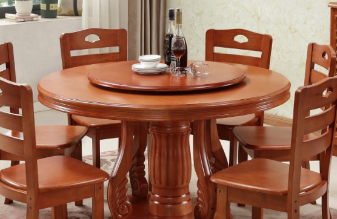

# Physics - 题目 627

**ID**: 962de01423e34ab9bfa9e9564b32feb1
**年级**: Grade 10
**难度**: Medium
**题型**: Calculation

## 题目
中式圆餐桌是我国传统家具，有的配有转盘，如图所示。​​​​​​​‌若质量为 $m$ 的小碗（可视为质点）放在水平转盘上随转盘一起匀速转动，小碗做匀速圆周运动的半径为 $r$ ，角速度为 $ω$ 。（1）画出小碗的受力分析；（2）求小碗做圆周运动时所需向心力的大小 $F$ ；（3）为保证小碗不被甩出，根据所学知识，提出一条安全使用转盘的建议。

## 解答

1. （1）小碗受到竖直向下的重力、竖直向上的支持力和指向圆心的静摩擦力，受力如图
2. 
3. （2）根据向心力的公式有 $F=mrω{^{2}}$
4. （3）小碗做圆周运动的向心力是由桌面给它的静摩擦提供的，为了不让小碗被甩出，可以采用的方法减小转盘的转动角速度。

## 知识点

**中文**:
  - 向心力的计算及应用

**English**:
  - Calculation and Application of Centripetal Force

---
