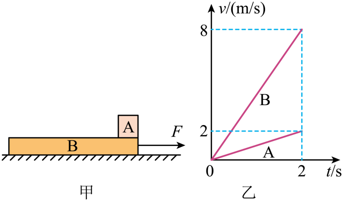

# Physics - 题目 2858

**ID**: 9e68fcf628a14f87b19885eec4b09979
**年级**: Grade 10
**难度**: Medium
**题型**: Calculation

## 题目
如图甲所示，粗糙水平地面上有一质量 $M=4{\rm{k}}{\rm{g}}$ 的足够长木板B，B与地面间的动摩擦因数 $μ{{}_{1}}=0.2$ ，将一质量 $m=4{\rm{k}}{\rm{g}}$ 的小物块A（视为质点）轻放在木板B的右端，从 $t=0$ 时刻起对B施加一水平向右的恒定拉力 ${\rm \mathit{F}，}t{{}_{1}}=2{\rm{s}}$ 时撤去拉力F，前2 s内A、B的 $v-t$ 图像如图乙所示，g取 $10{\rm{m}}/{\rm{s}}{^{2}}$ ，求：(1)0~2 s内A的加速度大小 $a{{}_{1}}$ 及A、B间的动摩擦因数 $μ{{}_{2}}$ ；(2)恒力F的大小；(3)A、B均停止运动后，A离B右端的距离L。​​​​​​​‌

## 解答

1. （1）由图乙可得0~2 s内A的加速度大小为 $a{{}_{1}}=\frac {Δv}{Δt}=\frac {2}{2}{\rm{m}}/{\rm{s}}{^{2}}=1{\rm{m}}/{\rm{s}}{^{2}}$
2. 0~2 s内对小物块A，由牛顿第二定律可得 $μ{{}_{2}}mg=ma{{}_{1}}$
3. 解得A、B间的动摩擦因数为 $μ{{}_{2}}=0.1$
4. （2）由图乙可得0~2 s内长木板B的加速度为 $a{{}_{2}}=\frac {8}{2}{\rm{m}}/{\rm{s}}{^{2}}=4{\rm{m}}/{\rm{s}}{^{2}}$
5. 地面对B的摩擦力大小为 $f{{}_{1}}=μ{{}_{1}}(M+m)g=16{\rm{N}}$
6. 向水平向左；A对B的摩擦力为大小 $f{{}_{2}}=μ{{}_{2}}mg=4{\rm{N}}$
7. 方向水平向左；则0~2 s内对长木板B，由牛顿第二定律可得 $F-f{{}_{1}}-f{{}_{2}}=Ma{{}_{2}}$
8. 解得 $F=36{\rm{N}}$
9. （3）撤去拉力后到共速前，小物块A的加速度大小为 $a^{′}{{{}_{1}}}=a{{}_{1}}=1{\rm{m}}/{\rm{s}}{^{2}}$
10. 设长木板B加速度大小 $a^{′}{{{}_{2}}}$ ，由 $f{{}_{1}}+f{{}_{2}}=Ma^{′}{{{}_{2}}}$
11. 解得 $a^{′}{{{}_{2}}}=5{\rm{m}}/{\rm{s}}{^{{{2}}}}$
12. 根据运动学公式可得 $v{{}_{1}}+a^{′}{{{}_{1}}}t{{}_{2}}=v{{}_{2}}-a^{′}{{{}_{2}}}t{{}_{2}}=v$
13. 其中 $v{{}_{1}}=2{\rm{m}}/{\rm{s}}$ ， $v{{}_{2}}=8{\rm{m}}/{\rm{s}}$ ，解得 $t{{}_{2}}=1{\rm{s}}$ ， $v=3{\rm{m}}/{\rm{s}}$
14. 即撤去拉力后经过 $t{{}_{2}}=1{\rm{s}}{\rm ，A}$ 、B达到共同速度 $v=3{\rm{m}}/{\rm{s}}$ ；因为 $μ{{}_{2}}<μ{{}_{1}}$ ，所以共速后A减速更慢，B减速更快，物块A的加速度大小为 $a^{′′}{{{}_{1}}}=1{\rm{m}}/{\rm{s}}{^{2}}$
15. 对长木板B有 $f{{}_{1}}-f{{}_{2}}=Ma^{′′}{{{}_{2}}}$
16. 解得 $a^{′′}{{{}_{2}}}=3{\rm{m}}/{\rm{s}}{^{2}}$
17. 整个过程中A的位移为 $x{{}_{{\rm{A}}}}=\frac {v{^{2}}}{2a{{}_{1}}}+\frac {v{^{2}}}{2a^{′′}{{{}_{1}}}}=9{\rm{m}}$
18. B的位移为 $x{{}_{{\rm{B}}}}=\frac {v{{}_{2}^{2}}}{2a{{}_{2}}}+\frac {v{^{2}}-v{{}_{2}^{2}}}{-2a^{′}{{{}_{2}}}}+\frac {v{^{2}}}{2a^{′′}{{{}_{2}}}}=15{\rm{m}}$
19. A、B均停止运动后，A离B右端的距离为 $L=x{{}_{{\rm{B}}}}-x{{}_{{\rm{A}}}}=6{\rm{m}}$

## 知识点

**中文**:
  - 板块模型

**English**:
  - Plate Model

---
