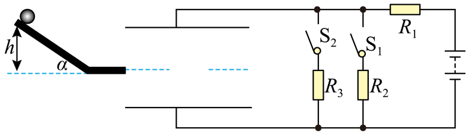

# Physics - 题目 1365

**ID**: 9f5c4253348147ca8f2e7352759fce57
**年级**: Grade 10
**难度**: Medium
**题型**: Calculation

## 题目
如图所示，光滑绝缘斜面底端与光滑绝缘水平轨道圆弧连接，水平轨道边缘紧靠平行板中心轴线．平行板和三个电阻构成如图所示电路，平行板板间距离 $d=0.6{\rm{\;}}{\rm{m}}$ ， $R{{}_{1}}=3{\rm{\;}}Ω$ ， $R{{}_{2}}=3{\rm{\;}}Ω$ ， $R{{}_{3}}=6{\rm{\;}}Ω$ ，电源内阻 $r=1{\rm{\;}}Ω$ 。​​​​​​​‌可以看为质点的带电小球，电荷量 $q=-0.01{\rm{\;}}{\rm{C}}$ ，质量 $m=0.03{\rm{\;}}{\rm{k}}{\rm{g}}$ ，从斜面顶端静止下滑。（1）若 ${\rm{S}}{{}_{{{1}}}}$ 、 ${\rm{S}}{{}_{2}}$ 均断开，小球刚好沿平行板中心轴线做直线运动，求电源电动势E；（2）若 ${\rm{S}}{{}_{{{1}}}}$ 、 ${\rm{S}}{{}_{2}}$ 均闭合，求电源的效率。

## 解答

1. （1）小球刚好沿平行板中心轴线做直线运动，则小球受到电场力与重力平衡，有 $mg=\frac {E}{d}q$ ，解得电源电动势为 $E=18{\rm{\;}}{\rm{V}}$ 。
2. （2）若 ${\rm{S}}{{}_{{{1}}}}$ 、 ${\rm{S}}{{}_{2}}$ 均闭合， $R{{}_{2}}$ 、 $R{{}_{3}}$ 的并联电阻为 $R=\frac {R{{}_{2}}R{{}_{3}}}{R{{}_{2}}+R{{}_{3}}}=2{\rm{\;}}\mathrm{Ω}$ ，根据闭合电路欧姆定律，电路中电流为 $I=\frac {E}{R{{}_{1}}+R+r}=3{\rm{\;}}{\rm{A}}$ 。电源的效率 $η=\frac {IU}{IE}=\frac {U}{E}=\frac {E-Ir}{E}=\frac {18-3\times 1}{18}\times 100\%=83.3\%$ 。

## 知识点

**中文**:
  - 闭合电路输出功率与效率

**English**:
  - Output Power and Efficiency of Closed Circuits

---
