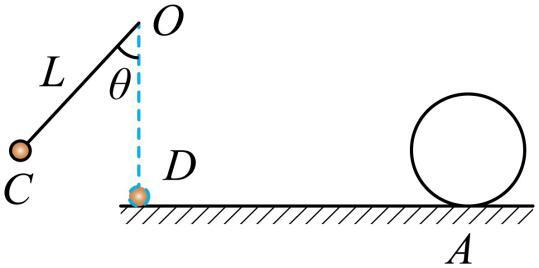

# Physics - 题目 766

**ID**: a25fa961ec0f4749acd7fb9051a57bb5
**年级**: Grade 10
**难度**: Medium
**题型**: Calculation

## 题目
如图所示，让摆球从图中的 $C$ 位置由静止开始摆下，摆到最低点 $D$ 处，摆线刚好被拉断，小球在粗糙的水平面上由 $D$ 点向右做匀减速运动，到达 $\mathrm{A}$ 孔进入半径 $R=0.3{\rm{m}}$ 的竖直放置的光滑圆轨道，当小球进入圆轨道立即关闭 $\mathrm{A}$ 孔。​​​​​​​‌已知摆线长 $L=1.6{\rm{m}}$ ，摆线能承受的最大拉力为 $F{{}_{{\rm{m}}}}=10{\rm{N}}$ ，小球可视为质点且质量 $m=0.5{\rm{k}}{\rm{g}}$ ， $D$ 点与 $\mathrm{A}$ 孔的水平距离 $s=2{\rm{m}}$ ， $g$ 取 $10{\rm{m}}/{\rm{s}}{^{2}}$ 。（1）求小球在 $C$ 位置时，摆线与竖直方向的夹角 $θ$ 多大；（2）要使摆球能进入圆轨道并且不脱离轨道，求摆球与粗糙水平面间的动摩擦因数 $μ$ 的范围。

## 解答

1. （1）当摆球由 $C$ 到 $D$ 运动，根据动能定理有 $mg\left ({L-L{\rm{c}}{\rm{o}}{\rm{s}}θ}\right )=\frac {1}{2}mv{{}_{{\rm{D}}}^{2}}$ ，
2. 在 $D$ 点，由牛顿第二定律可得 $F{{}_{{\rm{m}}}}-mg=m\frac {v{{}_{{\rm{D}}}^{2}}}{L}$ ，
3. 解得 $θ=60{^{\circ }}$ ；
4. （2）小球不脱离圆轨道分两种情况，
5. ①要保证小球能到达 $\mathrm{A}$ 孔，设小球到达 $\mathrm{A}$ 孔的速度恰好为零，由动能定理可得 $-μ{{}_{1}}mgs=0-\frac {1}{2}mv{{}_{{\rm{D}}}^{2}}$ ，
6. 可得 $μ{{}_{1}}=0.4$ ，
7. 若进入 $\mathrm{A}$ 孔的速度较小，那么小球将会在圆心以下做往返运动，不脱离轨道，其临界情况为到达圆心等高处速度为零，由动能定理可得 $-μ{{}_{2}}mgs-mgR=0-\frac {1}{2}mv{{}_{{\rm{D}}}^{2}}$ ，
8. 可求得 $μ{{}_{2}}=0.25$ ；
9. ②若小球能过圆轨道的最高点则不会脱离轨道，当小球恰好到达最高点时，在圆轨道的最高点，由牛顿第二定律可得 $mg=m\frac {v{^{2}}}{R}$ ，
10. 由动能定理可得 $-μ{{}_{3}}mgs-2mgR=\frac {1}{2}mv{^{2}}-\frac {1}{2}mv{{}_{{\rm{D}}}^{2}}$ ，
11. 解得 $μ{{}_{3}}=0.025$ ，
12. 综上所述，动摩擦因数 $μ$ 的范围为 $0.25⩽μ⩽0.4$ 或者 $μ⩽0.025$ 。

## 知识点

**中文**:
  - 应用动能定理求解多阶段、多过程问题

**English**:
  - Multi-stage/Multi-process Problems

---
