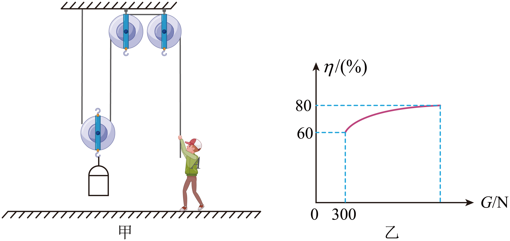

# Physics - 题目 873

**ID**: a8bbd51e246c41118d4bed2bf976fa57
**年级**: Grade 10
**难度**: Medium
**题型**: Calculation

## 题目
工人用如图甲所示的滑轮组运送建材上楼，每次运送量不定。​​​​​​​‌滑轮组的机械效率随建材重量变化的图像如图乙所示，滑轮和钢绳的摩擦力及绳重忽略不计， $g$ 取 $10{\rm{N}}/{\rm{k}}{\rm{g}}$ 。（1）若某次运送建材的质量为 $60{\rm{k}}{\rm{g}}$ ，则建材的重力是多少；（2）若工人在 $1{\rm{m}}{\rm{i}}{\rm{n}}$ 内将建材匀速竖直向上提升了 $15{\rm{m}}$ ，作用在钢绳上的拉力为 $300{\rm{N}}$ ，求拉力的功率。

## 解答

1. （1）若某次运送建材的质量为 $60{\rm{k}}{\rm{g}}$ ，则建材的重力为 $G=mg=60\times 10{\rm{N}}=600{\rm{N}}$
2. （2）由图可知，承担重物绳子的段数 $n\mathrm{=}2$ ，则 $1{\rm{m}}{\rm{i}}{\rm{n}}$ 内绳子自由端移动的距离为 $s=2h=30{\rm{m}}$
3. 拉力做的功为 $W=Fs=300\times 30{\rm{J}}=9000{\rm{J}}$
4. 拉力的功率为 $P=\frac {W}{t}=\frac {9000}{60}{\rm{W}}=150{\rm{W}}$

## 知识点

**中文**:
  - 力学

**English**:
  - Mechanics

---
