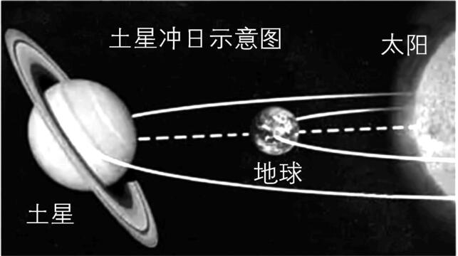

# Physics - 题目 494

**ID**: b2ae40f7f4d24555ad56ea68b5e99e51
**年级**: Grade 10
**难度**: Medium
**题型**: Calculation

## 题目
当某一地外行星（火星、木星、土星、天王星、海王星）在绕日公转过程中运行到与地球、太阳成一直线的状态，且地球恰好位于太阳和地外行星之间的这种天文现象叫“冲日”，冲日前后是观测地外行星的好时机．如图所示是土星冲日示意图，已知地球公转周期是1年，土星质量是地球的95倍，土星半径是地球的9．5倍，土星的公转半径是地球的9．5倍．忽略星球自转影响 ${\rm ．}(\sqrt{{9.​​​​​​​‌5}^{3}}\approx 29)$（1） 地球和太阳间的万有引力是土星和太阳间的几倍？（2） 土星冲日平均多长时间出现一次？（3） 假设人类在将来的某天登陆土星，若航天员在地面上最多能举起质量为 $m$ 的物体，则他在土星表面最多能举起质量是多少的物体？

## 解答

1. （1） 由万有引力定律有 $F=G\frac{Mm}{{r}^{2}}$ ,对地球有 ${F}_{地}=G\frac{M{m}_{地}}{{r}_{地}^{2}}$ ,对土星有 ${F}_{土}=G\frac{M{m}_{土}}{{r}_{土}^{2}}$ ,联立得 $\frac{{F}_{地}}{{F}_{土}}=\frac{{m}_{地}}{{m}_{土}}×\frac{{r}_{土}^{2}}{{r}_{地}^{2}}=0.95$ ．
2. （2） 行星绕太阳转动,万有引力提供向心力,可得 $G\frac{Mm}{{r}^{2}}=m{\left(\frac{2\mathrm{\pi }}{T}\right)^{2}}r$ ,得 $T=2\mathrm{\pi }\sqrt{\frac{{r}^{3}}{GM}}$ ,代入数据得土星的公转周期 ${T}_{土}=\sqrt{\frac{{r}_{土}^{3}}{{r}_{地}^{3}}}{T}_{地}\approx 29$ 年,设每隔时间 $t$ 出现一次土星冲日,则有 $({\omega }_{地}-{\omega }_{土})t=2\mathrm{\pi }$  , $\omega =\frac{2\mathrm{\pi }}{T}$ ,整理可得 $t=\frac{{T}_{地}{T}_{土}}{{T}_{土}-{T}_{地}}=\frac{29×1}{29-1}$  年 $=1.04$ 年．
3. （3） 在地球表面上有 $G\frac{{m}_{地}m}{{R}_{地}^{2}}=m{g}_{地}$ ,在土星表面上有 $G\frac{{m}_{土}m}{{R}_{土}^{2}}=m{g}_{土}$ ,联立得 $\frac{{g}_{地}}{{g}_{土}}=\frac{{m}_{地}}{{R}_{地}^{2}}×\frac{{R}_{土}^{2}}{{m}_{土}}=0.95$ ,设航天员在土星上举起物体的质量为 $m\prime $ ,则 $m{g}_{地}=m\prime {g}_{土}$ ,可得 $m\prime =0.95m$ ．

## 知识点

**中文**:
  - 万有引力定律问题的分析与计算
  - 计算某一星球的重力加速度

**English**:
  - Analysis and Calculation of Gravitation Problems
  - Calculating Gravitational Acceleration of a Planet

---
