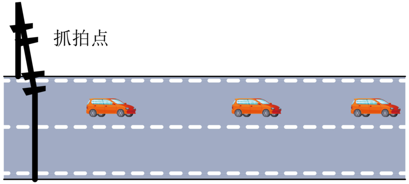

# Physics - 题目 2445

**ID**: b3470562880f471bb8b9823c395d0827
**年级**: Grade 10
**难度**: Medium
**题型**: Calculation

## 题目
在处理某高速公路交通事故时，交警借助监控测量仪对汽车的三次抓拍进行分析。​​​​​​​‌设定监控抓拍点正下方为坐标原点O，沿汽车前进方向建立坐标系，连续三次抓拍汽车的位置分别为 $x{{}_{1}}=15{\rm{m}}$ 、 $x{{}_{2}}=50{\rm{m}}$ 、 $x{{}_{3}}=75{\rm{m}}$ ，如图所示。已知相邻两次抓拍的时间间隔均为 $t=1{\rm{s}}$ ，整个过程汽车做匀减速直线运动。(1)求第一次抓拍到第三次抓拍过程中汽车的平均速度大小；(2)求汽车运动的加速度大小；(3)若该路段限速 $120{\rm{k}}{\rm{m}}/{\rm{h}}$ ，通过计算判断第一次抓拍时汽车是否超速。

## 解答

1. （1）第一次抓拍到第三次抓拍过程中汽车的平均速度大小为
2. ${\overline{v{{}_{13}}}}=\frac {x{{}_{13}}}{2t}=\frac {75-15}{2\times 1}{\rm{m}}/{\rm{s}}=30{\rm{m}}/{\rm{s}}$
3. （2）根据匀变速直线运动推论 $\Delta x=aT{^{2}}$ ，可得汽车运动的加速度大小为
4. $a=\frac {Δx}{T{^{2}}}=\frac {(50-15)-(75-50)}{1{^{2}}}{\rm{m}}/{\rm{s}}{^{2}}=10{\rm{m}}/{\rm{s}}{^{2}}$
5. （3）根据匀变速直线运动中间时刻速度等于该段过程的平均速度，则第二次抓拍时汽车的速度大小为
6. $v{{}_{2}}={\overline{v{{}_{13}}}}=30{\rm{m}}/{\rm{s}}$
7. 根据匀变速直线运动速度时间关系可得第一次抓拍时汽车的速度大小为
8. $v{{}_{1}}=v{{}_{2}}+at=40{\rm{m}}/{\rm{s}}=144{\rm{k}}{\rm{m}}/{\rm{h}}>120{\rm{k}}{\rm{m}}/{\rm{h}}$
9. 可知第一次抓拍时汽车超速。

## 知识点

**中文**:
  - 匀变速直线运动基本公式的灵活应用

**English**:
  - Flexible Application of Basic UVRM Formulas

---
