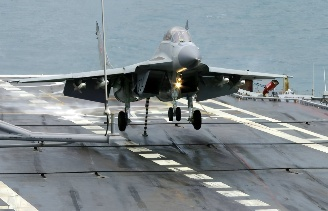

# Physics - 题目 3

**ID**: ba64e036a48041e89e7f59029d11743b
**年级**: Grade 10
**难度**: Medium
**题型**: Calculation

## 题目
航空母舰的舰载机既要在航母上起飞，也要在航母上降落，飞机在航母上降落时，需要用阻拦索使飞机迅速停下来。​​​​​​​‌若某次飞机着舰时的速度是 $90{\rm{m}}/{\rm{s}}$ ，飞机钩住阻拦索后经过2.5s停下来，将这段运动视为匀减速直线运动，此过程中，求：（1）飞机加速度的大小；（2）飞机滑行的距离；（3）飞机滑行的平均速度大小。

## 解答

1. （1）设加速度大小为a，滑行的距离为x
2. 由加速度定义得 $a=\frac {v}{t}$
3. 解得a=36m/s^{2}
4. （2）把飞机的减速运动看做反方向的初速度为零的加速运动，根据位移—时间公式得飞机滑行的距离为 $x=\frac {1}{2}at{^{2}}$
5. 解得x=112.5m
6. （3）飞机滑行的平均速度大小 ${\overline{v}}=\frac {x}{t}$
7. 解得 $\bar v=4.5{\rm{m}}{\rm{/}}{\rm{s}}$

## 知识点

**中文**:
  - 匀变速直线运动的位移—时间公式及其应用
  - 平均速度和瞬时速度、平均速率

**English**:
  - Displacement-Time Formula and Applications
  - Average Velocity, Instantaneous Velocity, and Average Speed

---
