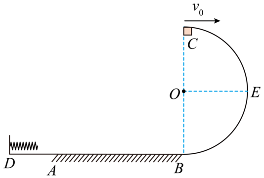

# Physics - 题目 2331

**ID**: c4f4de22f98f4d9ba5ffbee9a33a03b7
**年级**: Grade 10
**难度**: Medium
**题型**: Calculation

## 题目
如图所示，一轻弹簧左端固定于竖直墙面，水平面上A点左侧AD光滑，右侧AB粗糙，AB与光滑半圆轨道BEC平滑连接，轨道半径R=0.6m，E点和圆心O的连线与水平面平行。​​​​​​​‌一质量m=1kg的小物块（可视为质点）以某一水平向右的初速度，从C点进入半圆轨道内侧，沿半圆轨道滑下，第一次刚到达B点时，轨道对小物块的弹力大小为小物块重力的6倍。小物块与AB间的动摩擦因数μ=0.2，取重力加速度g=10m/s^{2}。求：（1）小物块第一次刚到B点时速度v_{B}的大小；（2）小物块刚进入半圆轨道最高点C时的水平初速度v_{0}的大小；（3）小物块与弹簧碰撞后，水平向右反向弹回，第一次返回半圆轨道后恰能到达E点。若小物块每次与弹簧碰撞过程中损失机械能0.2J，则小物块最终停止的位置距离A点多远。

## 解答

1. （1）滑块在B点时由牛顿第二定律 $F{{}_{{\rm{N}}}}-mg=m\frac {v{{}_{B}^{2}}}{R}$
2. 解得 $v{{}_{B}}=\sqrt {30}{\rm{m}}{\rm{/}}{\rm{s}}$
3. （2）从C到B由机械能守恒定律 $\frac {1}{2}mv{{}_{0}^{2}}+mg\cdot 2R=\frac {1}{2}mv{{}_{B}^{2}}$
4. 解得 $v{{}_{0}}=\sqrt {6}{\rm{m}}{\rm{/}}{\rm{s}}$
5. （3）小物块与弹簧碰撞后，水平向右反向弹回，第一次返回半圆轨道后恰能到达E点。由能量关系 $\frac {1}{2}mv{{}_{B}^{2}}=2{\rm μm}gL{{}_{AB}}+mgR+ΔE$
6. 解得L_{AB}=2.2m
7. 物块从E点返回时由能量关系 $mgR=ΔE+{\rm μm}gx$
8. 解得x=2.9m
9. 则小物块最终停止的位置距离A点2.9m-2.2m=0.7m。

## 知识点

**中文**:
  - 功能原理、能量守恒与曲线运动的综合

**English**:
  - Energy Conservation in Curvilinear Motion

---
