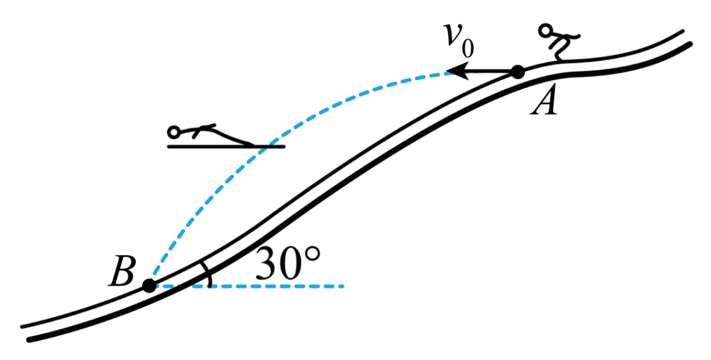

# Physics - 题目 1079

**ID**: c5a50f644ff4480294596494b30888b6
**年级**: Grade 10
**难度**: Medium
**题型**: Calculation

## 题目
跳台滑雪是一项勇敢者的运动，运动员穿专用滑雪板，在滑雪道上获得一定速度后从跳台飞出，在空中飞行一段距离后着陆。​​​​​​​‌如图，现有某运动员从跳台 $\mathrm{A}$ 处沿水平方向飞出，在斜坡 $B$ 处着陆，测得 $\mathrm{A}$ 、 $B$ 间的距离为 $90{\rm{m}}$ ，斜坡与水平方向的夹角为 $30\degree $ ，不计空气阻力，重力加速度 $g$ 取 $10{\rm{m}}/{\rm{s}}{^{2}}$ 。求：（结果可用根号表示）(1)运动员在空中飞行的时间；(2)运动员到 $B$ 处的速度大小；(3)运动员在空中离坡面的最大距离。

## 解答

1. （1）竖直方向 $h=\frac {1}{2}gt{^{2}}$
2. 由几何关系 $h=x{{}_{AB}}\sin 30\degree $
3. 联立得 $t=3{\rm{s}}$
4. （2）水平方向 $x=v{{}_{0}}t$
5. 由几何关系 $x=x{{}_{AB}}{\cos}30\degree $
6. 到达 $B$ 点的竖直速度 $v{{}_{y}}$ ，则 $v{{}_{y}}=gt$
7. 到达 $B$ 点的速度 $v{{}_{B}}=\sqrt {v{{}_{0}^{2}}+v{{}_{y}^{2}}}$
8. 解得 $v{{}_{B}}=15\sqrt {7}{\rm{m}}/{\rm{s}}$
9. （3）以 $\mathrm{A}$ 点为原点，沿斜面和垂直于斜面建立直角坐标系，如图所示
10. 
11. 从开始运动到离斜面最远点： $y$ 轴方向 $0-{\left({v{{}_{0}}\sin 30\degree }\right)^{2}}=-2gd{\cos}30\degree $
12. 解得最大距离 $d=\frac {45\sqrt {3}}{8}{\rm{m}}$

## 知识点

**中文**:
  - 平抛运动与斜面、圆轨道相结合问题

**English**:
  - Horizontal Projectile on Inclined Planes and Circular Tracks

---
