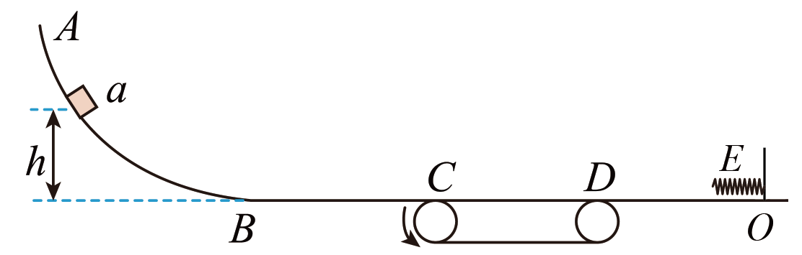

# Physics - 题目 1129

**ID**: d2ba93d463cc47bfa7f9729394d590c2
**年级**: Grade 10
**难度**: Medium
**题型**: Calculation

## 题目
如图所示，竖直平面内固定有半径为R=1 m的光滑四分之一圆轨道AB、水平直轨道BC、DO以及以速度v=3 m/s逆时针转动的水平传送带CD，OD上有一轻质弹簧，一端固定在O点另一端自然伸长于E点，各轨道平滑连接。​​​​​​​‌现有一质量为m=2 kg的滑块（可视为质点）从轨道AB上高为h处由静止下滑，已知L_{BC}=0.2 m，L_{CD}=0.4 m，L_{DE}=0.3 m，滑块与BC和DE间的动摩擦因数均为μ_{1}=0.3，与传送带间的动摩擦因数为μ_{2}=0.5，E点右侧平面光滑，整个过程不超过弹簧的弹性限度，重力加速度g取10 m/s^{2}。（1）若h=0.2 m，求滑块运动至B处时对轨道的作用力F_{N}；（2）若要使滑块能到达D点，且不再离开DE，求滑块下落高度满足的条件；（3）若滑块第一次到达D点速度恰为0，求这一过程滑块通过传送带产生的热能。

## 解答

1. （1）滑块由静止滑到B点处，由动能定理可得 $mgh=\frac {1}{2}mv{{}_{B}^{2}}$ ，代入数据解得 $v{{}_{B}}={{2}}{\rm{\;}}{\rm{m}}{\rm{/}}{\rm{s}}$ ，滑块滑动到B处时，由牛顿第二定律可得 $F{{}_{{\rm{N}}}}{^{\prime }}-mg=m\frac {v{{}_{B}^{2}}}{R}$ ，代入数据解得 $F{{}_{{\rm{N}}}}{^{\prime }}=28{\rm{\;}}{\rm{N}}$ ，由牛顿第三定律可知，滑块运动至B处时对轨道的作用力大小 $F{{}_{{\rm{N}}}}=F{{}_{{\rm{N}}}}{^{\prime }}=28{\rm{\;}}{\rm{N}}$ ，方向竖直向下。
2. （2）若要使滑块能到达D点，设滑块第一次到达D点时速度是零，下滑高度有最小值，由动能定理可得 $mgh{{}_{1}}-μ{{}_{1}}mgL{{}_{BC}}-μ{{}_{2}}mgL{{}_{CD}}=0$ ，代入数据解得 $h{{}_{1}}=0.26{\rm{\;}}{\rm{m}}$ ，滑块到达DE后且不再离开DE，可知又返回的D点速度恰好是零，下滑高度有最大值，由动能定理可得 $mgh{{}_{2}}-μ{{}_{1}}mgL{{}_{BC}}-μ{{}_{2}}mgL{{}_{CD}}-2μ{{}_{1}}mgL{{}_{DE}}=0$ ，解得 $h{{}_{2}}=0.44{\rm{\;}}{\rm{m}}$ ，则有滑块下落高度满足的条件 $0.26{\rm{\;}}{\rm{m}}⩽h⩽0.44{\rm{\;}}{\rm{m}}$ 。
3. （3）若滑块第一次到达D点速度恰是0，则对滑块有 $L{{}_{CD}}=\frac {1}{2}μ{{}_{3}}gt{^{2}}$ ，传送带有 $x=vt$ ，划痕为 $Δx=L{{}_{CD}}+x$ ，代入数据解得滑块在传送带上产生的热能 $Q=μ{{}_{3}}mgΔx=16{\rm{\;}}{\rm{J}}$ 。

## 知识点

**中文**:
  - 传送带模型中的能量守恒问题

**English**:
  - Energy Conservation in Conveyor Belt Models

---
