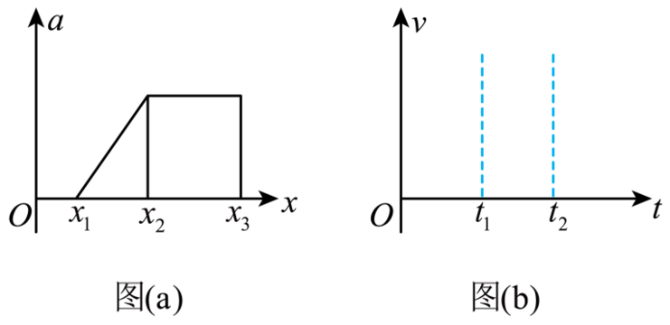

# Physics - 题目 1143

**ID**: dacd57363c8e405da8f405fbecf77f80
**年级**: Grade 10
**难度**: Medium
**题型**: Calculation

## 题目
一汽车以某一速度在平直公路上匀速行驶。​​​​​​​‌行驶过程中，司机忽然发现前方有一警示牌后立即刹车。刹车过程中，汽车运动加速度随位移变化可简化为图（a）中的图线。从司机发现警示牌到采取措施期间为反应时间（这段时间内汽车所受阻力已忽略，汽车仍保持匀速行驶），x_{1}-x_{2}段位移为刹车系统的启动阶段，位移为15 m，从x_{2}位置开始，汽车的刹车系统稳定工作，直至汽车停止，已知从x_{2}位置开始计时，汽车第1 s内的位移为12 m，第4 s内的位移为0.5 m。(1)在图（b）中定性画出从司机发现警示牌到刹车系统稳定工作后汽车运动的v-t图线（t_{1}对应x_{1}，t_{2}对应x_{2}）；(2)求x_{2}位置汽车的速度大小及此后的加速度大小；(3)微元法是一种常用的研究方法，对于直线运动，教科书中评解了如何由 $v-t$ 图像来求位移。请你借鉴此方法，求汽车的初速度 $v{{}_{0}}$ 的大小。

## 解答

1. （1）由 $a-x$ 图像可知，汽车先做匀速运动，然后做加速度增加的减速运动，最后做匀减速运动，而 $v-t$ 图像如图
2. 
3. （2）设汽车在x_{1}位置的速度为 $v{{}_{0}}$ ， $x{{}_{2}}$ 位置的速度为 $v$ ，在 $x{{}_{2}}$ 位置后一段时间内汽车做匀减速运动，设其加速度大小为 $a$ ，由题意汽车第 $1{\rm{\;}}{\rm{s}}$ 内的位移为 $12{\rm{\;}}{\rm{m}}$ ，第 $4{\rm{\;}}{\rm{s}}$ 内的位移为 $0.5{\rm{\;}}{\rm{m}}$ ，假设第 $4$ 秒内汽车未停下来。则第 $1{\rm{\;}}{\rm{s}}$ 内平均速度为 $12{\rm{\;}}{\rm{m}}{\rm{/}}{\rm{s}}$ ，第 $4{\rm{\;}}{\rm{s}}$ 内平均速度为 $0.5{\rm{\;}}{\rm{m}}{\rm{/}}{\rm{s}}$ ，则加速度大小为 $a{{}_{1}}=\frac {12-0.5}{3.5-0.5}{\rm{\;}}{\rm{m}}{\rm{/}}{\rm{s}}{^{{{2}}}}=\frac {23}{6}{\rm{\;}}{\rm{m}}{\rm{/}}{\rm{s}}{^{{{2}}}}$ ,代入数据求得第 $4{\rm{\;}}{\rm{s}}$ 末速度为负值；故假设错误。说明物体在第 $4{\rm{\;}}{\rm{s}}$ 内已经停下来；取 $t=1{\rm{\;}}{\rm{s}}$ ，由运动学公式第 ${{1}}{\rm{\;}}{\rm{s}}$ 内有 $12=vt-\frac {1}{2}at{^{2}}$ ,第 ${{3}}{\rm{\;}}{\rm{s}}$ 末速度为 $v{{}_{3}}=v-3at$ ，对 ${{3}}{\rm{\;}}{\rm{s}}$ 后有 $v{{}_{3}^{2}}=2a\times 0.5$ ，联立解得 $v=14{\rm{\;}}{\rm{m}}{\rm{/}}{\rm{s}}$ , $a=4{\rm{\;}}{\rm{m}}{\rm{/}}{\rm{s}}{^{{{2}}}}$ ；
4. (3)汽车从x_{1}位置到 $x{{}_{2}}$ 位置过程中做加速度增大的减速运动；取极小一段时间 ${\rm{Δ}}t$ 可认为汽车做匀减速运动，由运动学公式 $v{{}_{1}^{2}}-v{{}_{0}^{2}}=2a{{}_{1}}Δx{{}_{1}}$ 可得， $v{{}_{2}^{2}}-v{{}_{1}^{2}}=2a{{}_{2}}Δx{{}_{2}}$ ， $v{{}_{3}^{2}}-v{{}_{2}^{2}}=2a{{}_{3}}Δx{{}_{3}}$ ， $v{^{2}}-v{{}_{n}^{2}}=2a{{}_{4}}Δx{{}_{n}}$ ，所有式子相加得 $v{^{2}}-v{{}_{0}^{2}}=-2\left ({a{{}_{1}}{\rm{Δ}}x{{}_{1}}+a{{}_{2}}{\rm{Δ}}x{{}_{2}}+a{{}_{3}}{\rm{Δ}}x{{}_{3}}+\cdots \cdots +a{{}_{n}}{\rm{Δ}}x{{}_{n}}}\right )$  $a{{}_{1}}Δx{{}_{1}}+a{{}_{2}}Δx{{}_{2}}+a{{}_{3}}Δx{{}_{3}}+\cdots \cdots +a{{}_{n}}Δx{{}_{n}}$ 则表示 $a-x$ 图像围成面积。由图可知 $x{{}_{1}}\sim x{{}_{2}}$ 段图像的面积 $S=\frac {1}{2}\times 4\times 15=30$ ，结合上式可得 $v{{}_{0}}=16{\rm{\;}}{\rm{m}}{\rm{/}}{\rm{s}}$ 。

## 知识点

**中文**:
  - 刹车问题

**English**:
  - Braking Problems

---
