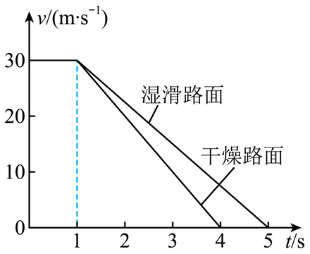

# Physics - 题目 1421

**ID**: f1a3a9dd4a0141259db196cb3ec65510
**年级**: Grade 10
**难度**: Medium
**题型**: Calculation

## 题目
雨雪天气时路面湿滑，汽车在紧急刹车时的刹车距离会明显增加。​​​​​​​‌如图所示为驾驶员驾驶同一辆汽车在两种路面紧急刹车时的 $v-t$ 图像，驾驶员的反应时间为1s。求：(1)从 $t={{1}}{\rm{s}}$ 到停下，汽车在湿滑路面的加速度和干燥路面的加速度大小；(2)从 $t=0$ 到停下，汽车在湿滑路面的行驶距离和在干燥路面的行驶距离；(3)从 $t=0$ 到停下，汽车在湿滑路面行驶的平均速度大小。

## 解答

1. （1）从 $t={{1}}{\rm{s}}$ 到停下，汽车在湿滑路面的加速度大小 $a{{}_{1}}=|\frac {\Delta v{{}_{1}}}{\Delta t{{}_{1}}}|=|\frac {0-30}{5-1}|{\rm{m}}{\rm{/}}{\rm{s}}{^{{{2}}}}=7.5{\rm{m}}{\rm{/}}{\rm{s}}{^{{{2}}}}$ ，干燥路面的加速度大小 $a{{}_{2}}=|\frac {\Delta v{{}_{2}}}{\Delta t{{}_{2}}}|=|\frac {0-30}{4-1}|{\rm{m}}{\rm{/}}{\rm{s}}{^{{{2}}}}=10{\rm{m}}{\rm{/}}{\rm{s}}{^{{{2}}}}$
2. （2） $v-t$ 图像与时间轴围成的面积代表位移，从 $t=0$ 到停下，汽车在湿滑路面的行驶距离 $x{{}_{1}}=\frac {1+5}{2}\times 30{\rm{m}}{\rm{=}}{{9}}{{0}}{\rm{m}}$ ，在干燥路面的行驶距离 $x{{}_{2}}=\frac {1+4}{2}\times 30{\rm{m}}{\rm{=}}{{7}}{{5}}{\rm{m}}$
3. （3）从 $t=0$ 到停下，汽车在湿滑路面行驶的平均速度大小 ${\overline{v}}=\frac {x{{}_{1}}}{t{{}_{1}}}=\frac {{{9}}{{0}}}{5}{\rm{m}}{\rm{/}}{\rm{s}}{\rm{=}}{{1}}{{8}}{\rm{m}}{\rm{/}}{\rm{s}}$

## 知识点

**中文**:
  - 刹车问题

**English**:
  - Braking Problems

---
