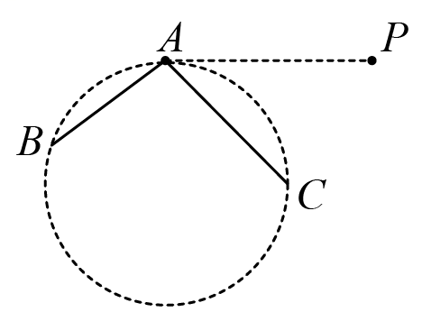

# Physics - 题目 894

**ID**: f2d680291c764f14aa421edd1b4b15b6
**年级**: Grade 10
**难度**: Medium
**题型**: Calculation

## 题目
滑滑梯是小朋友们爱玩的游戏。​​​​​​​‌有两部直滑梯 $AB$ 和 $AC$ ， $\mathrm{A}$ 、 $B$ 、 $C$ 在竖直平面内的同一圆周上，且 $\mathrm{A}$ 为圆周的最高点，示意图如图所示。已知圆半径为 $R$ 。在圆周所在的竖直平面内有一位置 $P$ ，距离 $\mathrm{A}$ 点为 $3R$ 且与 $\mathrm{A}$ 等高。各滑梯的摩擦均不计，已知重力加速度为 $g$ 。（1）如果小朋友由静止开始分别沿 $AB$ 和 $AC$ 滑下，试通过计算说明两次沿滑梯运动的时间关系；（2）若设计一部上端在 $P$ 点，下端在圆周上某点的直滑梯，则小朋友沿此滑梯由静止滑下时，在滑梯上运动的最短时间是多少。

## 解答

1. （1）设AB与水平方向的夹角为 $θ$ ，小朋友沿AB下滑时的加速度为
2. $a=g\sin θ$
3. $x{{}_{AB}}=\frac {1}{2}at{{}_{AB}}{^{2}}$
4. 由几何关系可知
5. $x{{}_{AB}}=2R\sin θ$
6. 联立解得
7. $t{{}_{{\rm{A}}{\rm{B}}}}=\sqrt {\frac {4R}{g}}$
8. 由上式可知小朋友的下滑时间与角度无关，则两次沿滑梯运动的时间关系为
9. $t{{}_{AB}}=t{{}_{AC}}{\rm{=}}\sqrt {\frac {4R}{g}}$
10. （2）根据第一问的结论，画出以P点为最高点的半径为r的等时圆，如图所示
11. 
12. 两圆相切时，时间最短，有
13. ${\left({R+r}\right)^{2}}={\left({R-r}\right)^{2}}+{\left({3R}\right)^{2}}$
14. 解得
15. $r=\frac {9}{4}R$
16. 用第一问的结论有
17. $t=\sqrt {\frac {9R}{g}}$

## 知识点

**中文**:
  - 两类动力学问题

**English**:
  - Two Types of Dynamics Problems

---
