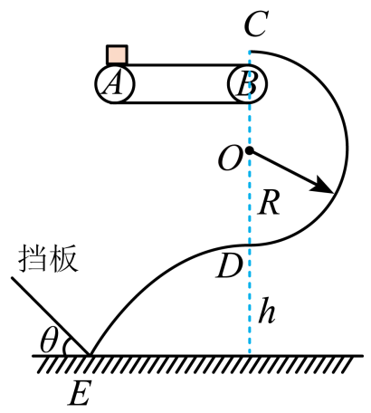

# Physics - 题目 2922

**ID**: f4d43cdd89c14ef2a0bb868f39e0e74d
**年级**: Grade 10
**难度**: Medium
**题型**: Calculation

## 题目
如图所示，水平传送带沿顺时针方向传动，质量为 $m=1{\rm{k}}{\rm{g}}$ 的小物块由静止轻轻放上传送带，从A点随传送带运动到水平部分的最右端B点，经半圆轨道C点沿圆弧切线进入竖直光滑的半圆轨道，恰能做圆周运动。​​​​​​​‌C点在B点的正上方，D点为轨道的最低点。小物块离开D点后，做平抛运动，恰好垂直于倾斜挡板打在挡板跟水平面相交的E点。已知半圆轨道的半径 $R=0.9{\rm{m}}$ ，D点距水平面的高度 $h=0.75{\rm{m}}$ ，倾斜挡板与水平面间的夹角 $θ=60{}^\circ $ 物块与传送带间动摩擦因数为 $μ=0.3$ ，取 $g=10{\rm{m}}/{\rm{s}}{^{{\rm{2}}}}$ ，试求：（1）传送带A、B间的最小距离L；（2）小物块经过D点时对轨道压力的大小。

## 解答

1. （1）小物块过C点恰能做圆周运动，则在C点，根据牛顿第二定律 $mg=m\frac {v{{}_{C}^{2}}}{R}$ ，解得 $v{{}_{C}}=\sqrt {gR}=3{\rm{m}}/{\rm{s}}$ ，在传送带上根据牛顿第二定律推得 $a=μg=3{\rm{m}}/{\rm{s}}{^{{\rm{2}}}}$ ，根据运动学规律，加速位移 $s=\frac {v{^{2}}}{2a}=1.5{\rm{m}}{\rm{,}}L{{}_{{\rm \min }}}=1.5{\rm{m}}$
2. （2）物块离开D点后平抛到恰好垂直到板上E点，则 $h=\frac {1}{2}gt{^{2}}$ ， $v{{}_{y}}=gt$ ，解得 $v{{}_{y}}=\sqrt {15}{\rm{m}}/{\rm{s}}$ ，由 ${\tan}60{}^\circ =\frac {v{{}_{D}}}{v{{}_{y}}}$ ，联立解得 $v{{}_{D}}=\sqrt {45}{\rm{m}}/{\rm{s}}$ ，在D点，根据牛顿第二定律 $N-mg=m\frac {v{{}_{D}^{2}}}{R}$ ，代入解得 $N=60{\rm{N}}$ ，根据牛顿第三定律知，物块对轨道压力 $N{^{\prime }}=60{\rm{N}}$

## 知识点

**中文**:
  - 求解平抛运动、类平抛运动问题
  - 竖直面内圆周运动问题

**English**:
  - Solving Horizontal and Quasi-Horizontal Projectile Problems
  - Circular Motion in Vertical Plane

---
