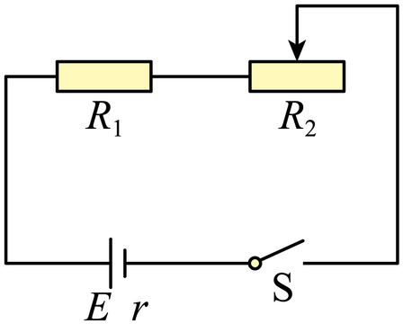

# Physics - 题目 1136

**ID**: f68b7540f76c419693156bafb8cb7b70
**年级**: Grade 10
**难度**: Medium
**题型**: Calculation

## 题目
如图所示，电源的电动势不变、内阻r=1.5 ${\rm{Ω}}$ ，定值电阻R_{1}=0.5 ${\rm{Ω}}$ ，滑动变阻器R_{2}的最大阻值为5 ${\rm{Ω}}$ ，求：（1）当电阻R_{1}消耗的功率最大时，滑动变阻器接入电路的电阻；（2）当滑动变阻器R_{2}消耗的功率最大时，滑动变阻器接入电路的电阻；（3）当电源的输出功率最大时，滑动变阻器接入电路的电阻。​​​​​​​‌

## 解答

1. （1）设 $P{{}_{1}}$ 为电阻 $R{{}_{1}}$ 消耗的功率，整个电路的电流为I_{1}，有
2. $P{{}_{1}}=I{{}_{1}^{2}}R{{}_{1}}$
3. 又
4. $I{{}_{1}}=\frac {E}{R{{}_{1}}+R{{}_{2}}+r}$
5. 则当 $R{{}_{2}}=0$ 时， $P{{}_{1}}$ 最大。
6. （2）设 $P{{}_{2}}$ 为电阻 $R{{}_{2}}$ 消耗的功率，有
7. $P{{}_{2}}=I{{}_{2}^{2}}R{{}_{2}}$
8. 又
9. $I{{}_{2}}=\frac {E}{R{{}_{1}}+R{{}_{2}}+r}$
10. 解得
11. $P{{}_{2}}=\frac {E{^{2}}R{{}_{2}}}{{\left({R{{}_{1}}+R{{}_{2}}+r}\right)^{2}}}=\frac {E{^{2}}}{R{{}_{2}}+\frac {{\left({R{{}_{1}}+r}\right)^{2}}}{R{{}_{2}}}+2\left ({R{{}_{1}}+r}\right )}$
12. 由基本不等式可知，当 $R{{}_{2}}=\left ({R{{}_{1}}+r}\right )=2Ω$ 时， $P{{}_{2}}$ 最大。
13. （3）设 $P{{}_{3}}$ 为电源输出功率，有
14. $P{{}_{3}}=I{{}_{3}^{2}}\left ({R{{}_{1}}+R{{}_{2}}}\right )$
15. 又
16. $I{{}_{3}}=\frac {E}{R{{}_{1}}+R{{}_{2}}+r}$
17. 解得
18. $P{{}_{3}}=\frac {E{^{2}}\left ({R{{}_{1}}+R{{}_{2}}}\right )}{{\left({R{{}_{1}}+R{{}_{2}}+r}\right)^{2}}}=\frac {E{^{2}}}{\left ({R{{}_{1}}+R{{}_{2}}}\right )+\frac {r{^{2}}}{R{{}_{1}}+R{{}_{2}}}+2r}$
19. 由基本不等式可知，当 $R{{}_{2}}=r-R{{}_{1}}=1Ω$ 时， $P{{}_{3}}$ 最大。

## 知识点

**中文**:
  - 电路的动态分析问题
  - 闭合电路的欧姆定律及其应用

**English**:
  - Dynamic Circuit Analysis
  - Ohm's Law for Closed Circuits and Applications

---
