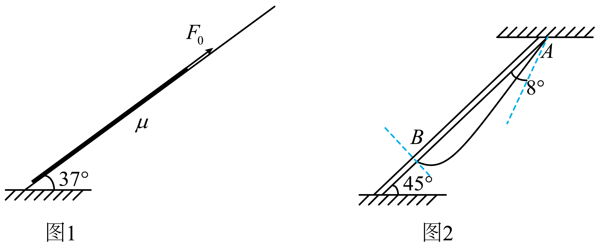

# Physics - 题目 2747

**ID**: f87e00a755e6436aba8ce76436d30025
**年级**: Grade 10
**难度**: Medium
**题型**: Calculation

## 题目
如图1所示，一根匀质绳放置在倾角为37°的斜面上，在沿着斜面向上的拉力 $F{{}_{0}}$ 的作用下会匀速上滑，斜面与绳之间的动摩擦因数为 $μ=0.75$ 。​​​​​​​‌现把该绳子悬挂在倾斜直杆上的 $\mathrm{A}$ 、 $B$ 两点间，如图2所示，直杆与水平方向的夹角为45°，绳端在 $\mathrm{A}$ 点的切线与直杆的夹角为8°，绳端在 $B$ 点的切线正好与直杆垂直。重力加速度为 $g$ ， $\sin 37\mathrm{°}=0.6$ ， ${\cos}37\mathrm{°}=0.8$ ，求：(1)绳的质量；(2)设 $\mathrm{A}$ 、 $B$ 两点对绳子的拉力分别为 $T{{}_{A}}$ 、 $T{{}_{B}}$ ，则 $T{{}_{A}}$ 、 $T{{}_{B}}$ 在竖直方向的分力之和为多大；(3) $\mathrm{A}$ 、 $B$ 两点对绳子的拉力大小 $T{{}_{A}}$ 、 $T{{}_{B}}$ 。

## 解答

1. （1）绳在沿着斜面向上的拉力 $F{{}_{0}}$ 的作用下会匀速上滑，则根据平衡条件可知 $F{{}_{0}}=mg\sin 37{}\degree +{\rm μm}g{\cos}37{}\degree $ ，解得 $m=\frac {5F{{}_{0}}}{6g}$
2. （2）由平衡条件可知， $T{{}_{A}}$ 、 $T{{}_{B}}$ 在竖直方向的分力与绳子的重力等大反向，绳子的重力为 $G=mg=\frac {5F{{}_{0}}}{6}$ 即， $T{{}_{A}}$ 、 $T{{}_{B}}$ 在竖直方向的分力之和大小为 $\frac {5F{{}_{0}}}{6}$ 。
3. （3）根据平衡条件，绳子在竖直方向合力为零，则 $T{{}_{B}}{\cos}45{}\degree +T{{}_{A}}{\cos}37{}\degree =G$ ，在水平方向合力为零，则 $T{{}_{B}}\sin 45{}\degree =T{{}_{A}}\sin 37{}\degree $ ，联立，解得 $T{{}_{A}}=\frac {25}{42}F{{}_{0}}$ ， $T{{}_{B}}=\frac {5\sqrt {2}}{14}F{{}_{0}}$

## 知识点

**中文**:
  - 正交分解法与三角形定则在平衡问题中的应用

**English**:
  - Orthogonal Decomposition and Triangle Rule in Equilibrium

---
