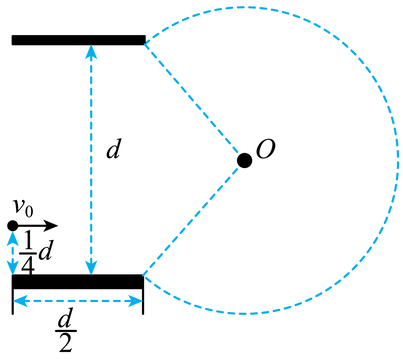

# Physics - 题目 1543

**ID**: fe44dd854eb2419d9ff91e6846b8d24b
**年级**: Grade 10
**难度**: Medium
**题型**: Calculation

## 题目
如图所示，间距为d、长度为  $\frac {d}{2}$ 的水平放置的平行金属板与电压为U的恒压电源相连，金属板右侧O点固定有一带正电的粒子甲。​​​​​​​‌一带负电的粒子乙从距离下板  $\frac {1}{4}d$ 的入射点以方向水平向右、大小为v₀的初速度射入平行金属板间，恰好从下板右侧边缘飞出，之后恰好仅在粒子甲的库仑力作用下做匀速圆周运动，最后从上板右侧边缘重新飞入平行金属板间。已知静电力常量为k，粒子甲、乙均可视为点电荷，不计粒子受到的重力，平行金属板间的电场可视为匀强电场，忽略平行金属板间电场与粒子甲产生的电场相互的影响，求：（1）粒子乙射出平行金属板时的速度大小；（2）粒子乙的比荷  $\frac {q}{m}；$（3）粒子甲的电荷量大小。

## 解答

1. （1）粒子乙在平行金属板间水平方向做匀速直线运动，有 $\frac {d}{2}=v{{}_{0}}t$ ，竖直方向做初速度为0的匀加速直线运动，有 $\frac {d}{4}=\frac {v{{}_{y}}}{2}t$ ，解得 $v{{}_{y}}=v{{}_{0}}$ ，因此粒子乙射出平行金属板时的速度大小 $v=\sqrt {v{{}_{0}}{^{2}}+v{{}_{y}}{^{2}}}=\sqrt {2}v{{}_{0}}$
2. （2）由动能定理有 $\frac {1}{4}qU=\frac {1}{2}m{\left({\sqrt {2}v{{}_{0}}}\right)^{2}}-\frac {1}{2}mv{{}_{0}^{2}}$ ，解得 $\frac {q}{m}=\frac {2v{{}_{0}}{^{2}}}{U}$
3. （3）设粒子乙射出平行金属板时的速度方向与水平方向夹角为 $θ$ ，则有 ${\rm{t}}{\rm{a}}{\rm{n}}θ=\frac {v{{}_{y}}}{v{{}_{0}}}$ ，解得 $θ=45{}\degree $ ，由几何条件分析可知，粒子乙做匀速圆周运动的半径 $R=\frac {\frac {d}{2}}{{\rm{c}}{\rm{o}}{\rm{s}}θ}$ ，解得 $R=\frac {\sqrt {2}}{2}d$ ，粒子乙做匀速圆周运动时由库仑力提供向心力，有 $k\frac {qQ}{R{^{2}}}=m\frac {v{^{2}}}{R}$ ，解得 $Q=\frac {\sqrt {2}Ud}{2k}$

## 知识点

**中文**:
  - 带电粒子在匀强电场中的运动

**English**:
  - Motion in Uniform Electric Field

---
