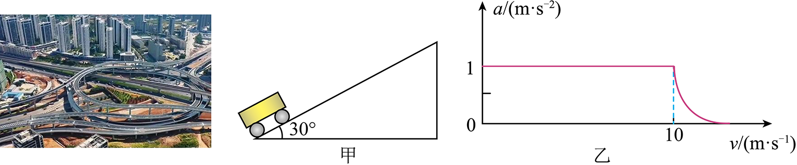

# Physics - 题目 1436

**ID**: fe9c5f017e68421498008423291e7a00
**年级**: Grade 10
**难度**: Medium
**题型**: Calculation

## 题目
义乌市机场路互通高架的建设将极大地改善市中心机场路与国贸大道的交通状况，实现车辆和行人的快速通行，从而提高城市交通的整体效率。​​​​​​​‌如图甲，高架桥的引桥可视为一个倾角θ为 $30{}\degree $ 的斜面。一质量m=2000kg的电动汽车从引桥底端由静止开始加速，其加速度a随速度v变化的关系如图乙所示，当电动汽车的速度达到10 m/s时，牵引力功率达到了额定功率并保持不变，且额定功率 $P=140{\rm{K}}{\rm{W}}$ 。假设行驶过程中电动汽车受到的阻力（摩擦和空气阻力）不变，重力加速度 $g=10{\rm{m}}/{\rm{s}}{^{2}}$ 。求：（1）汽车受到的阻力大小；（2）汽车能达到的最大速度；（3）第1 s内电动汽车机械能的增加量多大；（4）若速度达到10 m/s后，电动车再经2s达到最大速度，求这段时间里车子沿斜面运动了多少距离。

## 解答

1. （1）匀加速阶段，由图可知匀加速阶段最大速度 $v{{}_{1}}=10{\rm{m}}{\rm{/}}{\rm{s}}$ ， $a=1{\rm{m}}/{\rm{s}}{^{2}}$ ， $F{{}_{1}}=\frac {P}{v{{}_{1}}}=14\times 10{^{3}}{\rm{N}}$   ，对小车 $F{{}_{1}}-f-mg\sin θ=ma$   ，得 $f=2\times 10{^{3}}{\rm{N}}$
2. （2）匀速运动时速度最大 $F{{}_{2}}=f+mg\sin θ=12\times 10{^{3}}{\rm{N}}$   ， $v{{}_{2}}=\frac {P}{F{{}_{2}}}=\frac {35}{3}{\rm{m}}{\rm{/}}{\rm{s}}$
3. （3）动能增量 ${\rm{Δ}}E{{}_{{\rm{k}}}}=\frac {1}{2}mv{^{2}}=\frac {1}{2}m{\left({at}\right)^{2}}=1000{\rm{J}}$   ，重力势能增量 ${\rm{Δ}}E{{}_{{\rm{p}}}}=mgh=mg\frac {1}{2}at{^{2}}\sin 30{^{\circ }}=\frac {1}{4}mgat{^{2}}=5000{\rm{J}}$   ，机械能增量 ${\rm{Δ}}E=6000{\rm{J}}$
4. （4）达到最大速度前2s内根据动能定理有 $Pt-fx-mgx\sin 30{^{\circ }}=\frac {1}{2}mv{{}_{2}^{2}}-\frac {1}{2}mv{{}_{1}^{2}}$   ，得 $x=\frac {2195}{108}{\rm{m}}$

## 知识点

**中文**:
  - 机车启动的两种方式

**English**:
  - Two Modes of Locomotive Start-up

---
