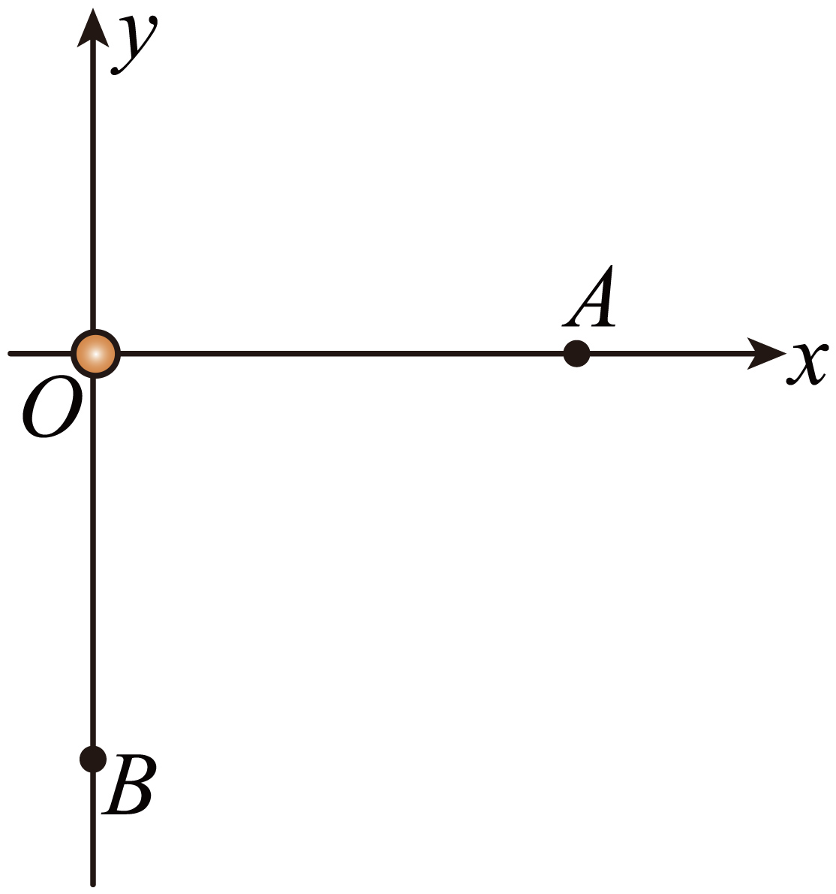

# Physics - 题目 612

**ID**: fec4187fcce14f65a4f2a7ded783a2d8
**年级**: Grade 10
**难度**: Medium
**题型**: Calculation

## 题目
如图所示，xOy为竖直平面内的直角坐标系，x轴正方向水平向右，y轴正方向竖直向上，该空间存在平行xOy平面但方向未知的匀强电场。​​​​​​​‌将一质量为m、带电量为q（q>0）的小球从O点抛出，抛出时的初速度大小均为 $v{{}_{0}}=\sqrt {2gd}$ ，抛出的方向可沿xOy平面内的任意方向。将小球沿某一方向抛出，一段时间后小球通过点A（4d，0）时速度大小为 $3\sqrt {2gd}$ ；仅改变小球从O点抛出的方向，一段时间后小球通过点B（0，-3.5d）时速度大小为 $4\sqrt {gd}$ 。已知重力加速度为g，求：(1)O、A两点间的电势差U_{OA}及O、B两点间的电势差U_{OB}；(2)电场强度的大小；(3)若初速度方向沿y轴正方向，小球运动过程中速度的最小值。

## 解答

1. （1）小球从O至A点过程有 $qU{{}_{OA}}=\frac {1}{2}mv{{}_{A}^{2}}-\frac {1}{2}mv{{}_{0}^{2}}$ 可得 $U{{}_{OA}}=\frac {8mgd}{q}$
2. 小球从O至B点过程有 $3.5mgd+qU{{}_{OB}}=\frac {1}{2}mv{{}_{B}^{2}}-\frac {1}{2}mv{{}_{0}^{2}}$ 可得 $U{{}_{OB}}=\frac {7mgd}{2q}$
3. （2）在x方向上电场强度分量为 $E{{}_{x}}=\frac {U{{}_{OA}}}{OA}=\frac {2mg}{q}$
4. 在y方向上电场强度分量为 $E{{}_{y}}=\frac {U{{}_{OB}}}{OB}=\frac {mg}{q}$ 可得 $E=\sqrt {E{{}_{x}^{2}}+E{{}_{y}^{2}}}=\frac {\sqrt {5}mg}{q}$
5. （3）由（2）可得 $F{{}_{x合}}=qE{{}_{x}}=2mg$ ； $F{{}_{y合}}=mg+qE{{}_{y}}=2mg$
6. 所以电场力和重力合力方向斜向下方，与x轴正方向夹角为45°，所以 $v{{}_{{\rm \min }}}=v{{}_{0}}{\cos}45{}\degree =\sqrt {gd}$

## 知识点

**中文**:
  - 带电粒子在匀强电场中的运动

**English**:
  - Motion in Uniform Electric Field

---
