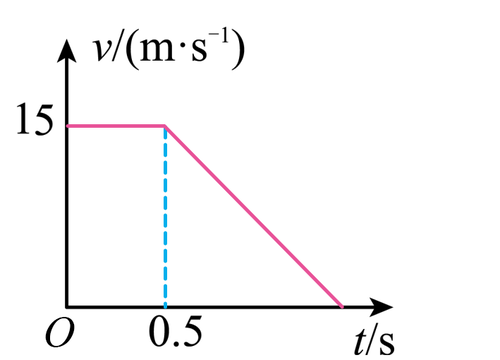

# Physics - 题目 1350

**ID**: ff4c39ad30d0499d9602a7f729612090
**年级**: Grade 10
**难度**: Medium
**题型**: Calculation

## 题目
一辆小汽车在城市道路以v_{0}=15m/s的速度匀速行驶，驾驶员发现正前方x=30m处的斑马线上有行人横过马路，于是刹车礼让行人，汽车恰好在斑马线前停下。​​​​​​​‌若驾驶员的反应时间为t_{0}=0.5s，汽车运动的v-t图像如图所示，驾驶员发现行人时作为记时起点。求：（1）汽车的加速度大小a；（2）从驾驶员发现行人到汽车静止过程的时间t。

## 解答

1. （1）汽车在t_{0}=0.5s内通过的位移 $x{{}_{1}}=v{{}_{0}}t{{}_{0}}=15\times 0.5{\rm{m}}=7.5{\rm{m}}$
2. 汽车减速运动过程中通过的位移 $x{{}_{2}}=x-x{{}_{1}}=22.5{\rm{m}}$
3. 根据匀变速直线运动规律有 $0-v{{}_{0}^{2}}=-2ax{{}_{2}}$
4. 代入数据解得 $a=5{\rm{m}}{\rm{/}}{\rm{s}}{^{{{2}}}}$
5. （2）汽车做匀减速运动过程的平均速度 ${\overline{v}}=\frac {v+v{{}_{0}}}{2}=\frac {0+15}{2}{\rm{m}}{\rm{/}}{\rm{s}}=7.5{\rm{m}}{\rm{/}}{\rm{s}}$
6. 汽车减速阶段运动的时间 $t{{}_{2}}=\frac {x{{}_{2}}}{{\overline{v}}}=\frac {22.5}{7.5}{\rm{s}}=3{\rm{s}}$
7. 从驾驶员发现行人到车停止运动的时间 $t=t{{}_{0}}+t{{}_{2}}=3.5{\rm{s}}$

## 知识点

**中文**:
  - 匀变速直线运动的v-t图像

**English**:
  - v-t Graphs of UVRM

---
