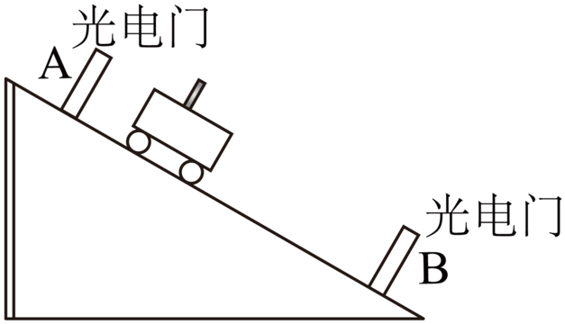

# Physics - 题目 1149

**ID**: 057f6d543a4f4ec99832aa3965d1bb2f
**年级**: Grade 10
**难度**: Medium
**题型**: Experiment

## 题目
为了“验证机械能守恒定律”，某学生想到用气垫导轨和光电门及质量为m的小车来进行实验，如图所示，他将长为L、原来已调至水平的气垫导轨的左端垫高H，在导轨上的两点处分别安装光电门A和B，然后将小车从导轨上端释放，在小车下滑过程中，小车上的挡光片经过上、下光电门的时间分别为t_{1}、t_{2}，用游标卡尺测得挡光片宽度为d，重力加速度为g。​​​​​​​‌则：（1）要验证小车在运动过程中机械能守恒，还必须测出。（2）写出本实验验证机械能守恒定律的原理式（用上面已知测量量和还必须测出的物理量符号表示）。（3）实验所用滑块的质量m＝600g，其他数据如下L=1.5m，H=10cm，g=9.8m/s^{2}，两个光电门间的距离为50cm，则实验中重力势能的减少量为J。

## 解答

1. （1）[1]很短时间内的平均速度等于瞬时速度，小车经过光电门A时的速度大小为 $v{{}_{1}}=\frac {d}{t{{}_{1}}}$ ，经过光电门B时的速度大小为 $v{{}_{2}}=\frac {d}{t{{}_{2}}}$ ，设A、B两光电门间的距离为x，设气垫导轨与水平面间的夹角为 $θ$ ，小车从光电门A到光电门B过程，由机械能守恒定律得 $mgx\sin θ=\frac {1}{2}mv{{}_{2}^{2}}-\frac {1}{2}mv{{}_{1}^{2}}$ ，由几何知识可知 $\sin θ=\frac {H}{L}$ ，整理得 $\frac {2gxH}{L}=\frac {d{^{2}}}{t{{}_{2}^{2}}}-\frac {d{^{2}}}{t{{}_{1}^{2}}}$ ，验证机械能守恒定律还需要测量值两光电门间的距离x；
2. （2）[2]由（1）可知，实验需要验证的表达式是 $\frac {2gxH}{L}=\frac {d{^{2}}}{t{{}_{2}^{2}}}-\frac {d{^{2}}}{t{{}_{1}^{2}}}$
3. （3）[3]实验中重力势能的减少量为 $ΔE{{}_{{\rm{p}}}}=mgx\sin θ=\frac {mgxH}{L}=\frac {0.600\times 9.8\times 0.50\times 0.10}{1.5}{\rm{J}}=0.196{\rm{J}}$

## 知识点

**中文**:
  - 实验：验证机械能守恒定律

**English**:
  - Experiment: Verifying Conservation of Mechanical Energy

---
