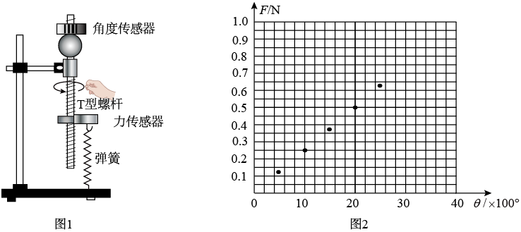

# Physics - 题目 758

**ID**: 5898e50b1fb04d05998c401e630f35b0
**年级**: Grade 10
**难度**: Medium
**题型**: Experiment

## 题目
2020年12月8日，中尼两国共同宣布了珠穆朗玛峰的最新高度为海拔8848.86米，此次珠峰高度测量使用了重力仪、超长距离测距仪等一大批国产现代测量设备。​​​​​​​‌重力仪的内部包含了由弹簧组成的静力平衡系统。为测量弹簧劲度系数，探究小组设计了如下实验，实验装置如图1所示，角度传感器固定在可转动的“T”形竖直螺杆上端，可显示螺杆转过的角度。“T”形螺杆中部套有螺母，螺母上固定力传感器。所测弹簧上端挂在力传感器上，下端固定在铁架台底座上，力传感器可显示弹簧弹力大小。“T”形螺杆转动时，力传感器会随着“T”形螺杆旋转而上下平移，弹簧长度随之发生变化。（1）该探究小组操作步骤如下：①旋转螺杆使弹簧初始长度等于原长，对应的角度传感器示数调为0；②旋转“T”形螺杆使弹簧长度增加，记录力传感器示数 $F$ 及角度传感器示数 $θ$ ；③多次旋转“T”形螺杆，重复步骤②的操作，记录多组对应 $F$ 、 $θ$ 值；④用所测数据作出 $F-θ$ 图像。图2已描出5个点，请在图中画出图像。（2）若螺杆的螺距（螺杆转动一周杆沿轴线前进的距离）为 $6{\rm{m}}{\rm{m}}$ ，则角度传感器示数为 $240{}\degree $ 时弹簧的伸长量 $x=$${\rm{m}}$ 。（3）由 $F-θ$ 图像可知弹力 $F$ 与弹簧的伸长量成正比（填“ $x$ ”、“ $x{^{2}}$ ”、“ $\frac {1}{x}$ ”），结合图像算出弹簧的劲度系数 $k=$${\rm{N}}/{\rm{m}}$ 。

## 解答

1. (1)[1]如图
2. 
3. (2)[2]转动的角度与移动的距离关系为 $\frac {6}{360{^{\circ }}}=\frac {x}{240{^{\circ }}}$ ，解得 $x=4{\rm{m}}{\rm{m}}=4\times 10{^{-3}}{\rm{m}}$
4. (3)[3]因为转动的角度与弹簧的伸长量成正比，而根据图像，转动的角度与弹簧弹力成正比，所以弹力 $F$ 与弹簧的伸长量 $x$ 成正比。
5. [4]由图可知，当角度为 $4000{}\degree $ 时，弹力为1N。此时的形变为 $\frac {6}{360{^{\circ }}}=\frac {x^{′}}{4000{^{\circ }}}$ ，解得 $x^{′}=\frac {200}{3}{\rm{m}}{\rm{m}}$ ，弹簧的劲度系数 $k=\frac {F}{x^{′}}=\frac {1000}{\frac {200}{3}}{\rm{N}}{\rm{/}}{\rm{m}}{\rm{=}}{{1}}{{5}}{\rm{N}}{\rm{/}}{\rm{m}}$

## 知识点

**中文**:
  - 实验：探究弹簧弹力和形变量的关系

**English**:
  - Experiment: Investigating Spring Force vs Deformation

---
