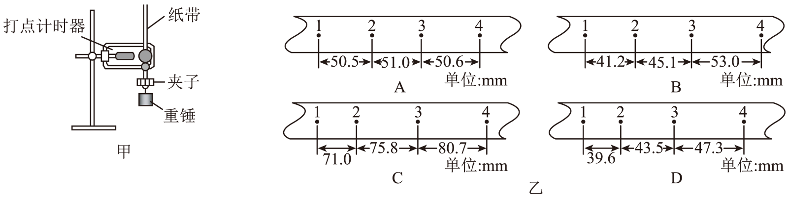
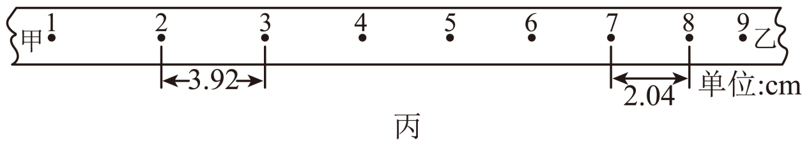

# Physics - 题目 412

**ID**: 71786a07876c4a3290e6defa7fba6ffb
**年级**: Grade 10
**难度**: Medium
**题型**: Experiment

## 题目
用打点计时器测定重力加速度，装置如图甲所示。​​​​​​​‌（1） 如果实验时所用交流电频率为50 Hz，已知当地的重力加速度大约为9.79 m/s^{2}，某同学选取了一条纸带并在该纸带上连续取了4个计时点（编号分别为1、2、3、4），且用刻度尺测出了相邻两个点间距离，则该同学所选的这条纸带是（图乙所示）（填写代号即可）。对于代号为D的纸带，打点计时器在打计时点3时重锤下落的速度v_{3}＝m/s（保留两位有效数字）。（2） 若打出的另一条纸带如图丙所示，实验时该纸带的（填“甲”或“乙”）端通过夹子和重物相连接，纸带上1至9各点为计时点，由纸带所示数据可算出实验时的重力加速度为m/s^{2}（保留两位有效数字）。

## 解答

1. （1）[1] 重物自由下落做匀加速运动，加速度为g，相邻计数点间的时间间隔 $0.02{\rm{s}}$  ，根据
2. $\Delta x=gT{^{2}}$
3. 得相邻的时间内的位移之差
4. $\Delta x=9.79\times 0.02{^{2}}{\rm{m}}=3.9{\rm{m}}{\rm{m}}$
5. 由图知，只有D符合
6. 故选D。
7. [2] 计时点3时重锤下落的速度
8. $v{{}_{3}}=\frac {x{{}_{24}}}{2T}=2.3{\rm{m}}{\rm{/}}{\rm{s}}{^{{{2}}}}$
9. （2）[3] 重物做匀加速运动，连续相等时间内通过的位移均匀增大，所以实验时该纸带的乙端通过夹子和重物相连接
10. [4] 由图知
11. $\mathrm{O}^{′}$
12. 得
13. $g=9.4{\rm{m}}{\rm{/}}{\rm{s}}{^{{{2}}}}$

## 知识点

**中文**:
  - 自由落体相关实验

**English**:
  - Experiments Related to Free Fall

---
