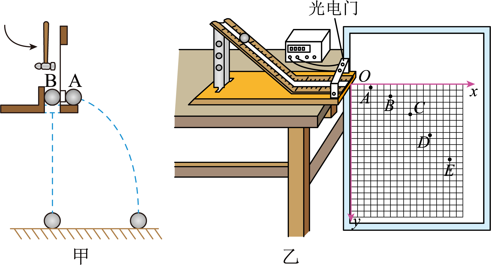

# Physics - 题目 341

**ID**: 81ee4c8aec7a40da95430869e48a630c
**年级**: Grade 10
**难度**: Medium
**题型**: Experiment

## 题目
某同学先后用图甲、乙两个实验装置，进行“探究平抛运动特点”的实验。​​​​​​​‌(1)在图甲装置中，用铁锤打击弹片，使A球水平抛出，同时B球自由落下，下列判断正确的是_。

## 解答

1. （1）A．实验中两球的质量不一定必须相等，因为两球下落的时间与质量无关，A错误；
2. BC．小锤打击弹性金属片，A球水平抛出，同时B球被松开自由下落，两球同时落地，可知平抛运动在竖直方向上做自由落体运动，不能得出水平方向上的运动规律，B正确；C错误；
3. D．A球在空中飞行时间与水平的初速度无关，因此增大打击弹片力度，A球在空中运动时间将不变，D错误。选B。
4. （2）①[1]每次需让小球从同一位置由静止释放，是为了保证小球的初速度大小相等。
5. ②[2]小球通过光电门时的瞬时速度为 $v{{}_{1}}=\frac {d}{t}$
6. ③[3]小球做平抛运动的初速度为 $v{{}_{2}}=\frac {12L}{4T}=\frac {3L}{T}$
7. ④[4]A．轨道斜面的作用是使小球获得一个水平初速度，小球在轨道斜面上受摩擦阻力并不影响 $v{{}_{2}}$ 的大小，A错误；
8. B．小球平抛运动过程受空气阻力，使得小球水平方向做减速运动，水平位移偏小， $v{{}_{2}}$ 值偏小，B正确；
9. C．小球经过光电门时，球心与光线不在同一高度，会造成遮光时间变短，则造成 $v{{}_{1}}$ 偏大，C正确。选BC。

## 知识点

**中文**:
  - 实验：探究平抛运动的特点

**English**:
  - Experiment: Characteristics of Projectile Motion

---
