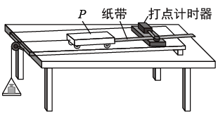

# Physics - 题目 1055

**ID**: 8523a8ad401043d2ad636770ff6a2e16
**年级**: Grade 10
**难度**: Medium
**题型**: Experiment

## 题目
如图为“探究加速度与力、质量的打点计时器关系”实验装置。​​​​​​​‌①本实验研究对象是；

## 解答

1. ①本实验研究对象是小车（含车内重物）P。
2. ②研究平抛运动、探究求合力的方法以及探究作用力与反作用力的关系实验中都不需要平衡摩擦阻力；探究功与速度变化的关系实验中需要平衡阻力，这样才能使得橡皮筋做的功等于小车合外力的功。

## 知识点

**中文**:
  - 实验：探究加速度与力、质量的关系

**English**:
  - Experiment: Acceleration vs Force and Mass (Newton's 2nd Law)

---
