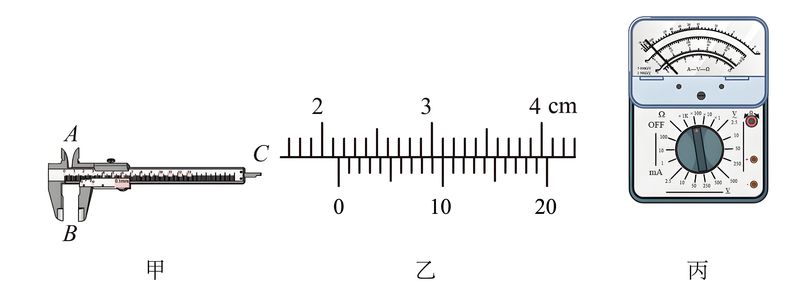
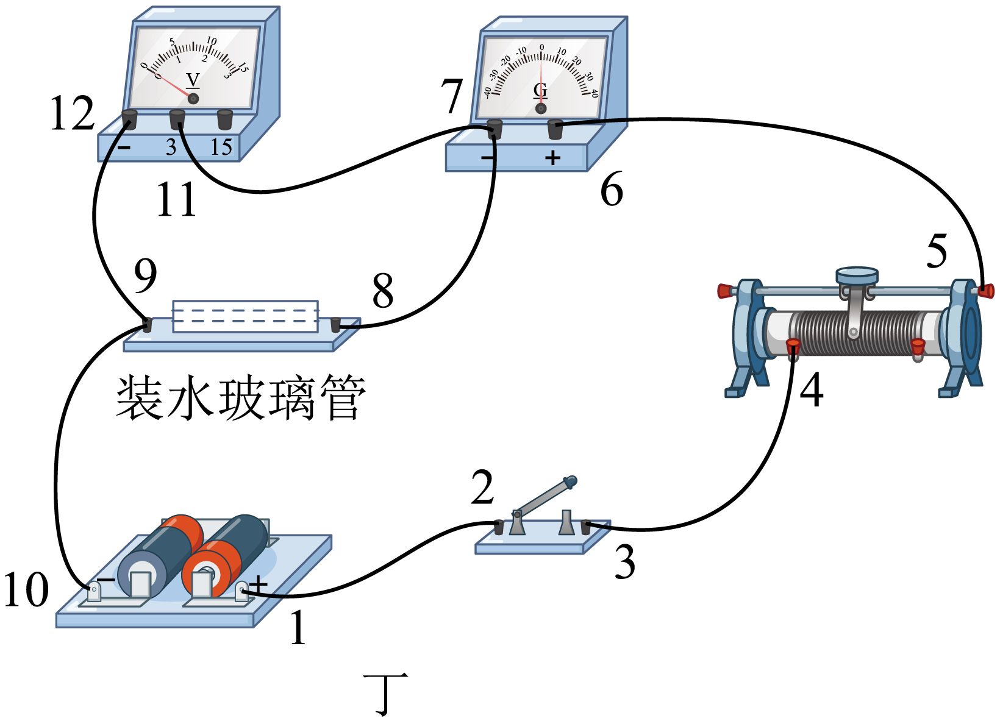
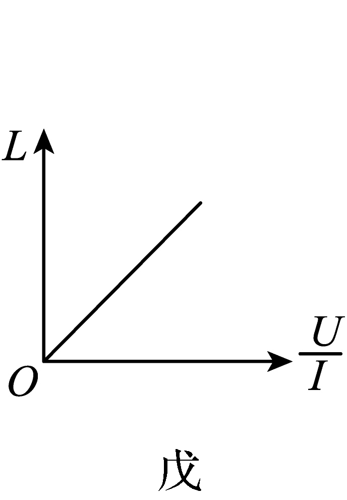

# Physics - 题目 2886

**ID**: 85bf2dce2dc745b2a3a12c7b5785479a
**年级**: Grade 10
**难度**: Medium
**题型**: Experiment

## 题目
某兴趣小组用一只两端开口的玻璃管通过密封塞封住一定量的矿泉水，测定该矿泉水的电阻率 $ρ$ 。​​​​​​​‌（1）某同学应用如图甲所示的游标卡尺的（选填“A”、“B”或“C”）部位去测玻璃管的内径d，测出的读数如图乙，则 $d=$mm。（2）该同学用多用电表的电阻挡测量玻璃管中矿泉水的电阻，选择开关置于“×100”挡，发现指针如图丙所示，则该同学应换选（选填“×10”或“ $\times 1{\rm{k}}$ ”）挡。（3）该组同学按图丁连好电路后，闭合开关，调节滑动变阻器的滑片，从最右端向左端移动的整个过程中，发现电压表有示数但几乎不变，可能的原因是。

## 解答

1. （1）游标卡尺来测量玻璃管内径应该用内爪，即A部分；游标卡尺的精确度为0.05mm，由图可得游标读数为 $d=21{\rm mm+}$  $10\times 0.05{\rm mm=21.50mm}$ 。
2. （2）由图可知欧姆表示数太大，故应选择更大倍率测量，即换“×1k”倍率。
3. （3）电压表有示数则干路一定是通的，电路中5、6之间不会断路，故A错误；电路中7、8之间断路后电压表被串联到电路中，会导致其电压接近电源电动势，调节滑动变阻器的滑片，从最右端向左端移动的整个过程中，发现电压表有示数但几乎不变，故B正确。
4. （4）由电阻定律可得 $R=ρ\frac {L}{S}=ρ\frac {L}{π(\frac {d}{2}){^{2}}}$ ，又因为 $R=\frac {U}{I}$ ，由图象可知 $k=\frac {L}{\frac {U}{I}}$ ，解得 $ρ=\frac {{\rm{π}}d{^{2}}}{4k}$ 。

## 知识点

**中文**:
  - 实验：导体电阻率的测量

**English**:
  - Experiment: Measuring Resistivity

---
