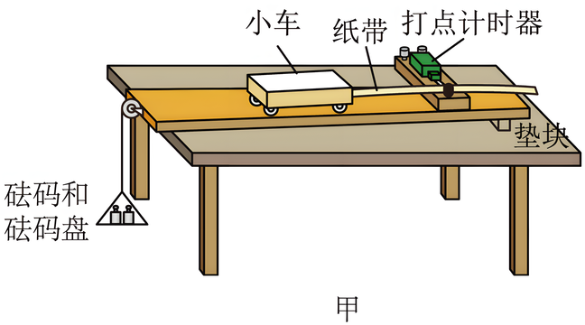
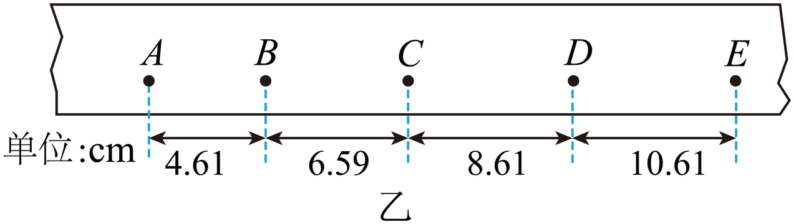

# Physics - 题目 2517

**ID**: cda80c80c8c04197b7fc17bfcfea40a6
**年级**: Grade 10
**难度**: Medium
**题型**: Experiment

## 题目
在“探究加速度与力、质量的关系”的实验中，采用如图甲所示的装置（g取 $10{\rm{m}}{\rm{/}}{\rm{s}}{^{{{2}}}}$ ）。​​​​​​​‌（1）除了图中所给器材以及交流电源和导线外，在下列器材中，还必须使用的器材是。（选填正确选项的字母）

## 解答

1. （1）[1]利用天平测量质量，利用打点计时器可以计时，打出的纸带需利用刻度尺测量长度求加速度，所以还需要天平（含砝码）和刻度尺，可以不需要弹簧测力计。
2. 故选BD。
3. （2）[2]平衡摩擦力是使小车拖动纸带在木板上做匀速直线运动，通过纸带上所打点是否均匀判断小车是否做匀速直线运动，若打出的纸带点迹是均匀的，则说明小车做匀速运动，摩擦力已被平衡。
4. （3）[3]相邻计数点之间还有4个点没有标出，则相邻计数点的时间间隔为
5. $T=0.1{\rm{s}}$
6. 利用纸带提供数据，可得打C点时的速度为
7. $v{{}_{C}}=\frac {x{{}_{BC}}+x{{}_{CD}}}{2T}=\frac {6.59+8.61}{2\times 0.1}\times 10{^{-2}}{\rm{m}}{\rm{/}}{\rm{s}}=0.760{\rm{m}}{\rm{/}}{\rm{s}}$
8. [4]根据逐差法，可得小车加速度大小为
9. $a=\frac {x{{}_{CE}}-x{{}_{AC}}}{4T{^{2}}}=\frac {(8.61+10.61-4.61-6.59)\times 10{^{-2}}}{4\times 0.1{^{2}}}{\rm{m}}{\rm{/}}{\rm{s}}{^{2}}\approx 2.01{\rm{m}}{\rm{/}}{\rm{s}}{^{2}}$
10. （4）[5]设小车的质量为 $M$ ，砝码和砝码盒的总质量为 $m$ ，以小车为对象，根据牛顿第二定律可得
11. $T=Ma$
12. 以砝码和砝码盒为对象，根据牛顿第二定律可得
13. $mg-T=ma$
14. 联立可得
15. $a=\frac {mg}{m+M}=\frac {1}{1+\frac {M}{m}}g$
16. 若不断增加砝码的质量，则小车的加速度大小将趋近于某一极限值，此极限值为g或 $10{\rm{m}}/{\rm{s}}{^{2}}$ 。

## 知识点

**中文**:
  - 实验：探究加速度与力、质量的关系

**English**:
  - Experiment: Acceleration vs Force and Mass (Newton's 2nd Law)

---
