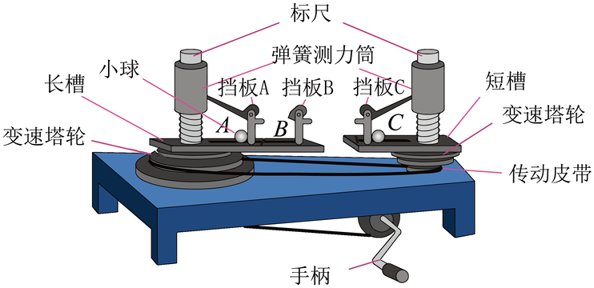

# Physics - 题目 2089

**ID**: d63f3be8ec7145238c01a2cc910ed1ba
**年级**: Grade 10
**难度**: Medium
**题型**: Experiment

## 题目
某实验小组用如图所示装置探究向心力大小F与质量m、角速度ω和半径r之间的关系，转动手柄使长槽和短槽分别随变速塔轮匀速转动，槽内的球就做匀速圆周运动。​​​​​​​‌横臂的挡板对球的压力提供了向心力，球对挡板的反作用力通过横臂的杠杆作用使弹簧测力套筒下降从而露出标尺，标尺上的红白相间的等分格显示出两个小球所受向心力的比值。(1)匀速转动手柄，使左右变速塔轮、长槽和短槽匀速转动，槽内的小球也随之做匀速圆周运动。小球挤压挡板使挡板另一端压缩测力套筒的弹簧，压缩量可从器件（选填 “弹簧测力筒”或“标尺”）上读出，该读数即显示了向心力的大小。本实验的实验方法与下列实验方法一致的是（选填“A”、“B”、“C”或“D”）。

## 解答

1. （1）[1]小球挤压挡板使挡板另一端压缩测力套筒的弹簧，压缩量可从器件标尺上读出，该读数即显示了向心力的大小。
2. [2]本实验的实验方法是控制变量法跟探究加速度与力、质量的关系实验一致，所以选择B项。
3. （2）探究向心力与角速度的关系，将质量相同的小球，分别放在挡板A、C处（半径相同），将皮带处于左右塔轮的半径不等的皮带轮上，两个轮转动的角速度不同。
4. （3）由 $ω=\frac {v}{r}$ ，结合题意可知，左右两塔轮转动的角速度之比为1：3，由 $F=mrω{^{2}}$ ，结合题意可知，左右两球半径之比为2∶1，质量之比3∶1，左右两球做圆周运动的向心力之比为2：3，即左、右标尺露出格数之比为2：3。

## 知识点

**中文**:
  - 实验：探究向心力的大小

**English**:
  - Experiment: Investigating Magnitude of Centripetal Force

---
