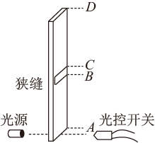

# Physics - 题目 2112

**ID**: dab643d57a2f47428c20745106485802
**年级**: Grade 10
**难度**: Medium
**题型**: Experiment

## 题目
某同学使用带有狭缝的钢片和光电计时器研究钢片下落的运动。​​​​​​​‌在钢片下落过程中，当钢片挡住光源发出的光时，计时器开始计时，挡光结束时终止计时；若再次挡光，计时器将重新开始计时，挡光结束时终止计时。狭缝方向与钢片两端平行，A、D为钢片的两端，B、C为狭缝的两边， $AB$ 、 $CD$ 的长度分别为 $d{{}_{1}}$ 和 $d{{}_{2}}$ 。实验中该同学将钢片从光电计时器上方某位置由静止释放，钢片竖直下落，狭缝保持水平。测得先后两段挡光时间分别为 $t{{}_{1}}$ 和 $t{{}_{2}}$ 。（1）钢片在 $\frac {t{{}_{1}}}{2}$ 时刻的速度大小为， $CD$ 段经过光电计时器的平均速度大小为；（2）若狭缝宽度很小，则钢片下落的加速度大小为（用字母 $t{{}_{1}}$ 、 $t{{}_{2}}$ 、 $d{{}_{1}}$ 、 $d{{}_{2}}$ 表示）；（3）若考虑到狭缝有一定宽度，则按照（2）中的方法得到的加速度值比真实值（填“偏大”或“偏小”）。

## 解答

1. （1）钢片在 $\frac {t{{}_{1}}}{2}$ 时刻的速度大小等于从A到B的平均速度，则为 $v{{}_{\frac {t{{}_{1}}}{2}}}=\frac {d{{}_{1}}}{t{{}_{1}}}{\rm ，\mathit{CD}}$ 段经过光电计时器的平均速度大小为 ${\overline{v{{}_{CD}}}}=\frac {d{{}_{2}}}{t{{}_{2}}}$
2. （2）钢片在 $t{{}_{1}}+\frac {t{{}_{2}}}{2}$ 时刻的速度大小等于从C到D的平均速度，即 $v{{}_{\frac {t{{}_{2}}}{2}}}=\frac {d{{}_{2}}}{t{{}_{2}}}$ ，则加速度 $a=\frac {v{{}_{\frac {t{{}_{2}}}{2}}}-v{{}_{\frac {t{{}_{1}}}{2}}}}{\frac {t{{}_{1}}+t{{}_{2}}}{2}}=\frac {\frac {d{{}_{2}}}{t{{}_{2}}}-\frac {d{{}_{1}}}{t{{}_{1}}}}{\frac {t{{}_{1}}+t{{}_{2}}}{2}}=\frac {2\left ({d{{}_{2}}t{{}_{1}}-d{{}_{1}}t{{}_{2}}}\right )}{t{{}_{1}}t{{}_{2}}\left ({t{{}_{1}}+t{{}_{2}}}\right )}$ 。
3. （3）若考虑到狭缝有一定宽度，则真实时间 $t>\frac {t{{}_{1}}+t{{}_{2}}}{2}$ ，按照（2）中的方法得到的加速度值比真实值偏大。

## 知识点

**中文**:
  - 实验：测定匀变速直线运动的加速度
  - 实验：测量做直线运动物体的瞬时速度

**English**:
  - Experiment: Determining Acceleration of UVRM
  - Experiment: Measuring Instantaneous Velocity

---
