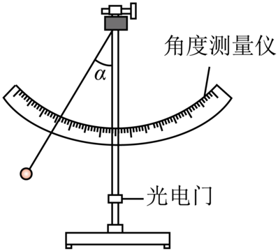

# Physics - 题目 1786

**ID**: fa713c3ae2ed4363a334fb82c673b5fb
**年级**: Grade 10
**难度**: Medium
**题型**: Experiment

## 题目
某实验小组用如图所示的装置进行实验，既可以验证机械能守恒定律，也可以测量当地的重力加速度，在铁架台上固定一角度测量仪，用一不可伸长的轻质细线拴接一直径为d、质量为m的小球，细线悬点到小球顶端的距离为L，自然下垂时小球刚好位于光电门处，将小球拉离平衡位置至对应的偏离角度为 $α$ ，然后由静止释放小球，记录小球通过光电门时的挡光时间t，多次改变偏离角度 $α$ ，重新做实验。​​​​​​​‌不计空气阻力。回答下列问题：(1)小球从静止摆动到最低点的过程中，重力势能的减小量为 $ΔE{{}_{{\rm{p}}}}=$（用m、g、L、d、 $α$ 来表示），小球运动到最低点时的速度大小 $v=$（用d、t来表示）。(2)通过实验数据，以 $\frac {1}{t{^{2}}}$ 为横轴，以 ${\cos}α$ 为纵轴，画出一条（填“直线”“抛物线”或“双曲线”）就验证了机械能守恒定律。(3)若（2）中得到的图线（或其延长线）与横轴交点的横坐标的绝对值为c，则当地的重力加速度大小 $g=$（用d、L、c来表示）。

## 解答

1. （1）[1]小球从静止摆动到最低点的过程中，重力势能的减小量 $ΔE{{}_{{\rm{p}}}}=mg\left ({L+0.5d}\right )\left ({1-{\cos}α}\right )$
2. [2] 小球通过光电门的时间极短，则其平均速度近似等于小球运动到最低点时的速度大小，有 $v=\frac {d}{t}$
3. （2）小球运动到最低点时的动能 $E{{}_{{\rm{k}}}}=\frac {1}{2}mv{^{2}}=\frac {md{^{2}}}{2t{^{2}}}$ ，若 $ΔE{{}_{{\rm{p}}}}=E{{}_{{\rm{k}}}}$ ，就验证了机械能守恒定律，整理可得 ${\cos}α=1-\frac {d{^{2}}}{g\left ({2L+d}\right )}\times \frac {1}{t{^{2}}}$ ，则以 $\frac {1}{t{^{2}}}$ 为横轴，以 ${\cos}α$ 为纵轴，画出的是一条直线。
4. （3）若画出的图线与横轴交点的横坐标的绝对值为c，则图像的斜率 $k=-\frac {1}{c}$ ，结合 $k=-\frac {d{^{2}}}{g\left ({2L+d}\right )}$ ，解得 $g=\frac {cd{^{2}}}{2L+d}$

## 知识点

**中文**:
  - 实验：验证机械能守恒定律

**English**:
  - Experiment: Verifying Conservation of Mechanical Energy

---
