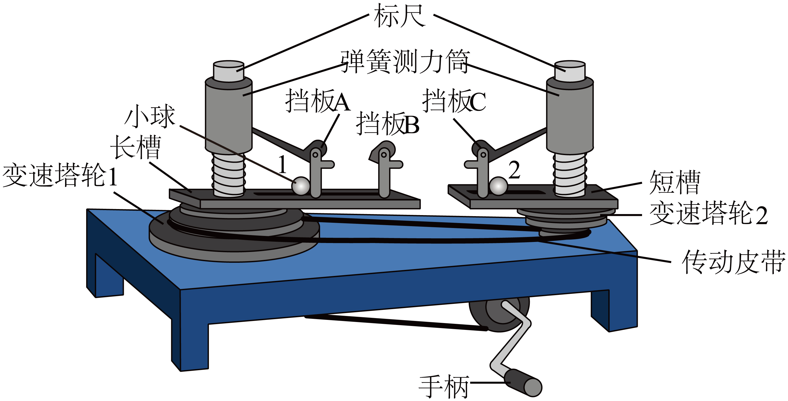

# Physics - 题目 2997

**ID**: fa966bdee8664e0db4e1129881c6109a
**年级**: Grade 10
**难度**: Medium
**题型**: Experiment

## 题目
小饶同学用如图所示的装置探究向心力F大小与质量m、角速度 $ω$ 和半径r之间关系表达式。​​​​​​​‌实验时转动手柄，通过皮带带动两个塔轮转动，使得槽内的钢球做匀速圆周运动，钢球对挡板的作用通过连杆使测力筒下降，露出的标尺刻度能表示两钢球所需向心力的大小。已知小球在挡板A、B、C处做匀速圆周运动的半径之比为1：2：1。(1)本实验所采用的实验探究方法是（填选项“A”或“B”）；

## 解答

1. （1）探究向心力 $F$ 与质量m、角速度 $ω$ 和半径r的关系，需控制其中一个物理量变化，其他物理量相同，采用了控制变量法。
2. （2）根据向心力公式 $F=mω{^{2}}r$ ，将两个质量不同的小球放在长槽挡板A和短槽挡板C上，两小球的运动半径相同，调节变速塔轮半径使两塔轮角速度相同，可探究向心力F的大小与质量的关系。
3. （3）根据向心力公式 $F=mω{^{2}}r$ ，可知则与皮带连接的两个变速塔轮的角速度之比为 $ω{{}_{1}}:ω{{}_{2}}=\sqrt {F{{}_{1}}}:\sqrt {F{{}_{2}}}=1:2$

## 知识点

**中文**:
  - 实验：探究向心力的大小

**English**:
  - Experiment: Investigating Magnitude of Centripetal Force

---
