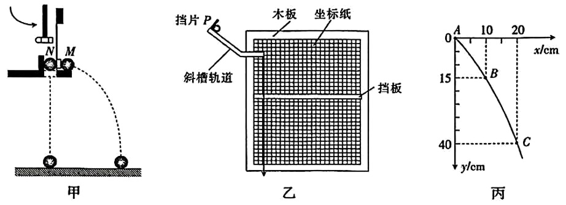

# Physics - 题目 2167

**ID**: fd63c1cc854b4b619da3a555acb9b34f
**年级**: Grade 10
**难度**: Medium
**题型**: Experiment

## 题目
某实验小组分别用图甲、乙所示的装置探究平抛运动的特点，重力加速度大小取  $10{\rm{m}}/{\rm{s}}{^{2}}。​​​​​​​‌$（1）用图甲装置进行的实验，是用来探究平抛运动在(选填“水平”或“竖直”)方向上的运动特点，多次实验后，发现M、N两球总是同时落地。（2）用图乙装置进行实验时，斜槽轨道末端(选填“需要”或“不需要”)水平，小球(选填“需要”或“不需要”)每次都从斜槽上同一位置由静止释放。（3）实验结果如图丙所示，某同学通过数据计算出小球从A点运动到C点的时间为t=0.2s，抛出时的初速度大小为  $v{{}_{0}}=$${\rm{m}}/{\rm{s}}$ 。

## 解答

1. （1）由于两球总是同时落地，说明平抛运动在竖直方向上做自由落体运动，因此图甲装置是探究平抛运动在竖直方向上的运动特点；
2. （2）为了确保小球抛出时做平抛运动，斜槽的末端必须水平；为了使小球每次平抛运动的初速度相同，必须将小球在同一位置由静止释放；
3. （3）由于平抛运动在水平方向做匀速直线运动，故小球抛出时的初速度 $v{{}_{0}}=\frac {x}{t}=\frac {0.20}{0.2}{\rm{m}}{\rm{/}}{\rm{s}}{\rm{=}}{{1}}{\rm{m}}{\rm{/}}{\rm{s}}$ 。

## 知识点

**中文**:
  - 实验：探究平抛运动的特点

**English**:
  - Experiment: Characteristics of Projectile Motion

---
