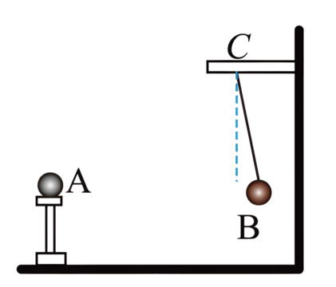

# Physics - 题目 1874

**ID**: f97f5c8022764fa580f188c210ba1690
**年级**: Grade 10
**难度**: Medium
**题型**: Fill-in-the-blank

## 题目
某实验小组探究两电荷间相互作用力的大小，一同学猜想可能与两电荷的间距和所带电荷量有关。​​​​​​​‌他选用均带正电的小球A和B，A球放在可移动的绝缘座上，B球用绝缘丝线悬挂于玻璃棒C点，如图所示。实验时，先保持两球电荷量不变，使A球从远处逐渐向B球靠近，观察到两球距离越小，B球悬线的偏角越大，再保持两球距离不变，改变小球所带的电荷量，观察到电荷量越大，B球悬线的偏角越大。实验表明：（1）两电荷之间的相互作用力，随其距离的（填“减小”或“增大”）而增大；（2）两电荷间的作用力随其所带电荷量的（填“减小”或“增大”）而增大；（3）此同学在探究中应用的科学方法是（填“累积法”“等效替代法”“控制变量法”或“演绎法”）。

## 解答

1. （1）保持两球电荷量不变，使A球从远处逐渐向B球靠近时，观察到两球间距离越小，B球悬线的偏角越大，说明此时两球间的相互作用力越大，即两球间距离越小，两球间的相互作用力越大；
2. （2）保持两球距离不变，改变小球所带的电荷量时，观察到电荷量越大，B球悬线的偏角越大，说明此时两球间的相互作用力大，即电荷量越大，两球间的相互作用力越大；
3. （3）由于两电荷间相互作用力的大小与两电荷间的距离和带电荷量有关，探究相互作用力随某个量变化时，此同学先保持其他量不变，采用了控制变量法进行探究。

## 知识点

**中文**:
  - 库仑定律的表达式和简单计算

**English**:
  - Expression and Simple Calculation of Coulomb's Law

---
