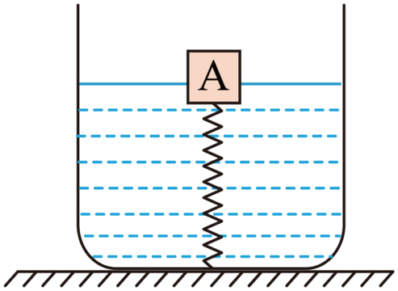

# Physics - 题目 1797

**ID**: 01a6109598d64c9f9af5d58520954d52
**年级**: Grade 10
**难度**: Medium-Hard
**题型**: Calculation

## 题目
在底面积为 500cm^{2}的长方体容器，质量为 1kg，在底部固定一轻质弹簧，弹簧上端连有一边长为0.1m的正方体物块A，当容器中水的深度为 20cm时，物块A有  $\frac {3}{5}$ 的体积露出水面，如图所示，此时弹簧恰好处于自然伸长状态。​​​​​​​‌往容器缓慢加水，至物块A刚好浸没水中，立即停止加水，弹簧伸长了 3cm。已知弹簧的伸长与所受的拉力成正比。（ρ_{水}=1.0×10^{3}kg/m^{3}，g取10N/kg）。求：（1） 物块A的密度；（2）A刚好浸没水中时，水对容器底的压强。（3）当弹簧伸长1cm时，容器底对桌面的压强。

## 解答

1. （1）物块A体积为 $V=L{^{3}}={\left({0.1{\rm{m}}}\right)^{3}}=10{^{-3}}{\rm{m}}{^{3}}$ ，排开水的体积 $V{{}_{排}}=V-V{{}_{露}}=V-\frac {3}{5}V=\frac {2}{5}V=\frac {2}{5}\times 10{^{-3}}{\rm{m}}{^{3}}=4\times 10{^{-4}}{\rm{m}}{^{3}}$ ，受到的浮力 $F{{}_{浮}}=ρ{{}_{水}}gV{{}_{排}}=1.0\times 10{^{3}}{\rm{k}}{\rm{g}}/{\rm{m}}{^{3}}\times 10{\rm{N}}/{\rm{k}}{\rm{g}}\times 4\times 10{^{-4}}{\rm{m}}{^{3}}=4{\rm{N}}$ ，弹簧恰好处于自然伸长状态时没有发生形变，此时 $F{{}_{浮}}{\rm{=}}G{\rm =4N}$ ，即 $ρ{{}_{水}}gV{{}_{排}}=ρgV$ ，则物块A的密度 $ρ=\frac {ρ{{}_{水}}gV{{}_{排}}}{gV}=\frac {V{{}_{排}}}{V}ρ{{}_{水}}=\frac {2}{5}\times 1.0\times 10{^{3}}{\rm{k}}{\rm{g}}/{\rm{m}}{^{3}}=0.4\times 10{^{3}}{\rm{k}}{\rm{g}}/{\rm{m}}{^{3}}$
2. （2）物块A刚好完全浸没水中，此时液体深度为 ${{2}}{{0}}{\rm{c}}{\rm{m}}+\frac {3}{5}\times 10{\rm{c}}{\rm{m}}+3{\rm{c}}{\rm{m}}{\rm{=}}{{2}}{{9}}{\rm{c}}{\rm{m}}{\rm{=}}{{0}}{{.}}{{2}}{{9}}{\rm{m}}$ ，此时水对容器底的压强是 $p=ρ{{}_{水}}gh=1.0\times {{1}}{{0}}{^{3}}{\rm{k}}{\rm{g}}/{\rm{m}}{^{3}}\times {{1}}{{0}}{\rm{N}}{\rm{/}}{\rm{k}}{\rm{g}}\times 0.29{\rm{m}}=2.9\times {{1}}{{0}}{^{3}}{\rm{P}}{\rm{a}}$
3. （3）A刚好浸没水中时，受到的浮力 $F{{}_{浮}}{^{\prime }}=ρ{{}_{水}}gV^{′}{{{}_{排}}}=1.0\times 10{^{3}}{\rm{k}}{\rm{g}}/{\rm{m}}{^{3}}\times 10{\rm{N}}/{\rm{k}}{\rm{g}}\times 1\times 10{^{-3}}{\rm{m}}{^{3}}=10{\rm{N}}$ ，设此时弹簧弹力为 $F{{}_{1}}$ ，由平衡条件 $F{{}_{浮}}{^{\prime }}=F{{}_{1}}+G$ ，得 $F{{}_{1}}=6{\rm{N}}$ ，当弹簧伸长1cm时,弹簧弹力为 $F{{}_{2}}$ ，已知弹簧的伸长与所受的拉力成正比，则 $F{{}_{2}}=\frac {1}{3}F{{}_{1}}=2{\rm{N}}$ ，设此时A受到的浮力为 $F{{}_{浮}}{^{\prime \prime }}$ ，由平衡条件得 $F{{}_{浮}}{^{\prime \prime }}=G+F{{}_{2}}$ ，解得 $F{{}_{浮}}{^{\prime \prime }}=6{\rm{N}}$ ，则A排开水的体积为 $V{{}_{排}}{^{^{′}}}=\frac {F{{}_{浮}}{^{^{′′}}}}{ρ{{}_{水}}g}=6\times 10{^{-4}}{\rm{m}}{^{3}}$ ，则A没入水中的深度 $h{{}_{1}}=\frac {6\times 10{^{-4}}}{0.1\times 0.1}{\rm{m}}={{0}}{{.}}{{0}}{{6}}{\rm{m}}=6{\rm{c}}{\rm{m}}$ ，此时水的深度 $h{{}_{2}}=20{\rm{c}}{\rm{m}}+{{6}}{\rm{c}}{\rm{m}}-{{4}}{\rm{c}}{\rm{m}}+{{1}}{\rm{c}}{\rm{m}}={{2}}{{3}}{\rm{c}}{\rm{m}}$ ，容器中水的重力 $G{{}_{1}}=ρ{{}_{水}}g(sh{{}_{2}}-\frac {3}{5}\times 0.1{^{3}})=109{\rm{N}}$ ，木块的重力 $G{{}_{2}}=ρg\times 0.1{^{3}}=4{\rm{N}}$ ，容器的重力 $G{{}_{3}}=mg=10{\rm{N}}$ ，容器底对桌面的压强 $p^{′}=\frac {G{{}_{1}}+G{{}_{2}}+G{{}_{3}}}{S}=\frac {109+4+10}{500\times 10{^{-4}}}{\rm{P}}{\rm{a}}=2.46\times 10{^{3}}{\rm{P}}{\rm{a}}$

## 知识点

**中文**:
  - 受力分析

**English**:
  - Force Analysis

---
