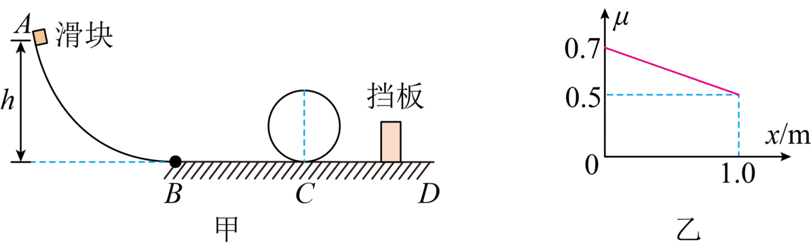

# Physics - 题目 2008

**ID**: 02c70f9500024ee7a0d147f4f88551e0
**年级**: Grade 10
**难度**: Medium-Hard
**题型**: Calculation

## 题目
如图甲，装置由弧形轨道 $AB$ 、竖直圆轨道（ $C$ 点位置轨道前后稍有错开）及水平直轨道 $BD$ 平滑连接而成。​​​​​​​‌水平轨道 $BC$ 段与滑块间的动摩擦因数 $μ$ 从左向右随距离 $x$ 均匀变化，如图乙所示。除 $BC$ 段外，其余轨道均光滑。现将质量 $m=0.1{\rm{k}}{\rm{g}}$ 的滑块（视为质点）从高度 $h=1.4{\rm{m}}$ 的 $\mathrm{A}$ 点静止释放，第一次通过圆轨道后与挡板碰撞反弹，恰好能第二次通过圆轨道最高点。已知圆轨道半径 $R=0.11{\rm{m}}$ ， $BC$ 段长 $x{{}_{0}}=1{\rm{m}}，g$ 取 $10{\rm{m}}{\rm{/}}{\rm{s}}{^{{{2}}}}$ 。求：（1）滑块第一次运动到 $B$ 点时的速度大小 $v{{}_{B}}$ ；（2）滑块第二次经过 $C$ 点时的动能 $E{{}_{{\rm{k}}C}}$ ；（3）滑块最终停在何处。

## 解答

1. （1）滑块从 $\mathrm{A}$ 点运动到 $B$ 点，由动能定理，有 $mgh=\frac {1}{2}mv{{}_{B}}{^{2}}-0$ ，
2. 解得 $v{{}_{B}}=2\sqrt {7}{\rm{m}}{\rm{/}}{\rm{s}}$ 。
3. （2）由题意，滑块反弹后恰好能从 $C$ 点通过圆轨道最高点，由动能定理，有 $-mg\cdot 2R=\frac {1}{2}mv^{′}{{^{2}}}-E{{}_{{\rm{k}}C}}$ ，
4. 在圆轨道最高点，有 $mg=m\frac {v^{′}{{^{2}}}}{R}$ ，
5. 联立，解得 $E{{}_{{\rm{k}}C}}=0.275{\rm{J}}$ 。
6. （3）由题意，利用面积法可得滑块经过 $BC$ 段，滑动摩擦力做功为 $W{{}_{{\rm{f}}}}=-\frac {1}{2}\times \left ({0.5+0.7}\right )\times 1.0\times 0.1\times 10{\rm{J}}=-0.6{\rm{J}}$ ，
7. 而 $E{{}_{{\rm{k}}C}}=0.275{\rm{J}}<0.6{\rm{J}}$ ，
8. 则滑块不能回到 $B$ 点，设其还能向左运动位移为 $L{\rm{m}}$ ，如图所示
9. 
10. 则由几何关系可知，在停止位置，接触面间的动摩擦因数 $μ{{}_{1}}=0.5+0.2L$ ，
11. 由动能定理，有 $W{{}_{{\rm{f}}{{1}}}}=0-E{{}_{{\rm{k}}C}}$ ，
12. 由面积法，有 $W{{}_{{\rm{f}}{{1}}}}=-\frac {1}{2}\times \left ({0.5+μ{{}_{1}}}\right )\times L\times 0.1\times 10{\rm{J}}$ ，
13. 联立，解得 $L=0.5$ 或 $-5.5$ （舍去），
14. 则 $x=1.0{\rm{m}}-0.5{\rm{m}}=0.5{\rm{m}}$ ，
15. 即滑块最终停止位置为 $B$ 点右侧0.5m处。

## 知识点

**中文**:
  - 应用动能定理求解与图像相关的动能问题

**English**:
  - Graph-related Kinetic Energy Problems

---
