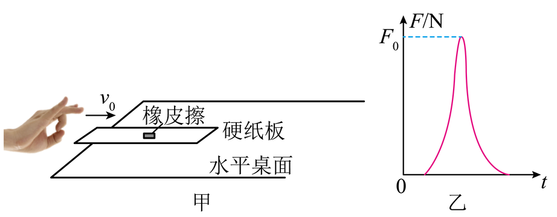

# Physics - 题目 1844

**ID**: 054d0ac5f1ba453aad8d2d530c749cb6
**年级**: Grade 10
**难度**: Medium-Hard
**题型**: Calculation

## 题目
某兴趣小组对一个惯性实验进行研究。​​​​​​​‌如图甲所示，长方形硬纸板放在水平桌面上，纸板一端稍稍伸出桌外，将一块橡皮擦置于纸板的正中间，手指水平弹向纸板，纸板水平飞出，橡皮擦脱离纸板。已知橡皮擦质量为 $m{{}_{1}}=20{\rm{g}}$ ，硬纸板的质量为 $m{{}_{2}}=20{\rm{g}}$ ，硬纸板长度 $L=20{\rm{c}}{\rm{m}}$ ，橡皮擦与纸板间的动摩擦因数为 $μ{{}_{1}}=0.2$ ，纸板与桌面间的动摩擦因数为 $μ{{}_{2}}=0.3$ ，认为所有接触面处最大静摩擦力等于滑动摩擦力，橡皮擦可视为质点且不会翻滚，重力加速度 $g=10{\rm{m}}{\rm{/}}{\rm{s}}{^{2}}$ 。求：(1)若手指与纸板间的作用力随时间变化如图乙所示，则要使橡皮擦相对纸板滑动， $F{{}_{0}}$ 至少多大？(2)手指对纸板的作用时间很短，可认为作用结束后，纸板获得速度 $v{{}_{0}}$ 但位移为零。要使橡皮擦脱离纸板， $v{{}_{0}}$ 至少多大？(3)手指对纸板的作用时间很短，可认为作用结束后，纸板获得速度 $v{{}_{0}}$ 但位移为零。若 $v{{}_{0}}=1.0{\rm{m}}/{\rm{s}}$ ，橡皮擦和硬纸板均停止时，橡皮擦和硬纸板之间的相对位移大小。

## 解答

1. （1）对橡皮擦和纸板整体分析得 $F{{}_{0}}-μ{{}_{2}}(m{{}_{1}}+m{{}_{2}})g=(m{{}_{1}}+m{{}_{2}})a{{}_{0}}$
2. 对橡皮擦分析，当橡皮擦所受摩擦达到最大时，此时恰好相对滑动，则有 $μ{{}_{1}}m{{}_{1}}g=m{{}_{1}}a{{}_{0}}$
3. 联立解得 $a{{}_{0}}=2{\rm{m}}/{\rm{s}}{^{2}}$ ， $F{{}_{0}}=0.2{\rm{N}}$
4. （2）由分析得两物体速度恰好相等时，橡皮擦相对纸板向左位移最大；对橡皮擦受力分析得 $μ{{}_{1}}m{{}_{1}}g=m{{}_{1}}a{{}_{1}}$
5. 解得加速度大小为 $a{{}_{1}}=2{\rm{m}}/{\rm{s}}{^{2}}$
6. 对纸板分析得 $μ{{}_{2}}(m{{}_{1}}+m{{}_{2}})g+μ{{}_{1}}m{{}_{1}}g=m{{}_{2}}a{{}_{2}}$
7. 解得加速度大小为 $a{{}_{2}}=8{\rm{m}}/{\rm{s}}{^{2}}$
8. 开始运动到速度相等时，有 $v=v{{}_{0}}-a{{}_{2}}t=a{{}_{1}}t$
9. 又 $x{{}_{2}}-x{{}_{1}}=\frac {v{{}_{0}}+v}{2}t-\frac {v}{2}t=\frac {L}{2}$
10. 联立解得 $v{{}_{0}}=\sqrt {2}{\rm{m}}/{\rm{s}}$
11. （3）若 $v{{}_{0}}=1.0{\rm{m}}/{\rm{s}}$ ，设经过 $t{{}_{1}}$ 时间，橡皮擦与纸板共速，则有 $v{{}_{1}}=v{{}_{0}}-a{{}_{2}}t{{}_{1}}=a{{}_{1}}t{{}_{1}}$
12. 解得 $t{{}_{1}}=0.1{\rm{s}}$ ， $v{{}_{1}}=0.2{\rm{m}}/{\rm{s}}$
13. 该过程橡皮擦相对纸板向左发生的位移大小为 $Δx{{}_{1}}=\frac {v{{}_{0}}+v{{}_{1}}}{2}t{{}_{1}}-\frac {v{{}_{1}}}{2}t{{}_{1}}=0.05{\rm{m}}$
14. 共速后，由于 $μ{{}_{1}}=0.2<μ{{}_{2}}=0.3$ ，可知橡皮擦相对于纸板向右运动，对橡皮擦受力分析得 $μ{{}_{1}}m{{}_{1}}g=m{{}_{1}}a{{}_{3}}$
15. 解得加速度大小为 $a{{}_{3}}=2{\rm{m}}/{\rm{s}}{^{2}}$
16. 方向向左；对纸板分析得 $μ{{}_{2}}(m{{}_{1}}+m{{}_{2}})g-μ{{}_{1}}m{{}_{1}}g=m{{}_{2}}a{{}_{4}}$
17. 解得加速度大小为 $a{{}_{4}}=4{\rm{m}}/{\rm{s}}{^{2}}$
18. 方向向左；从共速到两者都停止运动，该过程橡皮擦相对纸板向右发生的位移大小为 $Δx{{}_{2}}=\frac {v{{}_{1}^{2}}}{2a{{}_{3}}}-\frac {v{{}_{1}^{2}}}{2a{{}_{4}}}=0.005{\rm{m}}$
19. 则橡皮擦和硬纸板均停止时，橡皮擦和硬纸板之间的相对位移大小为 $Δx=Δx{{}_{1}}-Δx{{}_{2}}=0.045{\rm{m}}$

## 知识点

**中文**:
  - 牛顿运动定律与图像结合问题

**English**:
  - Newton's Laws and Graphs

---
